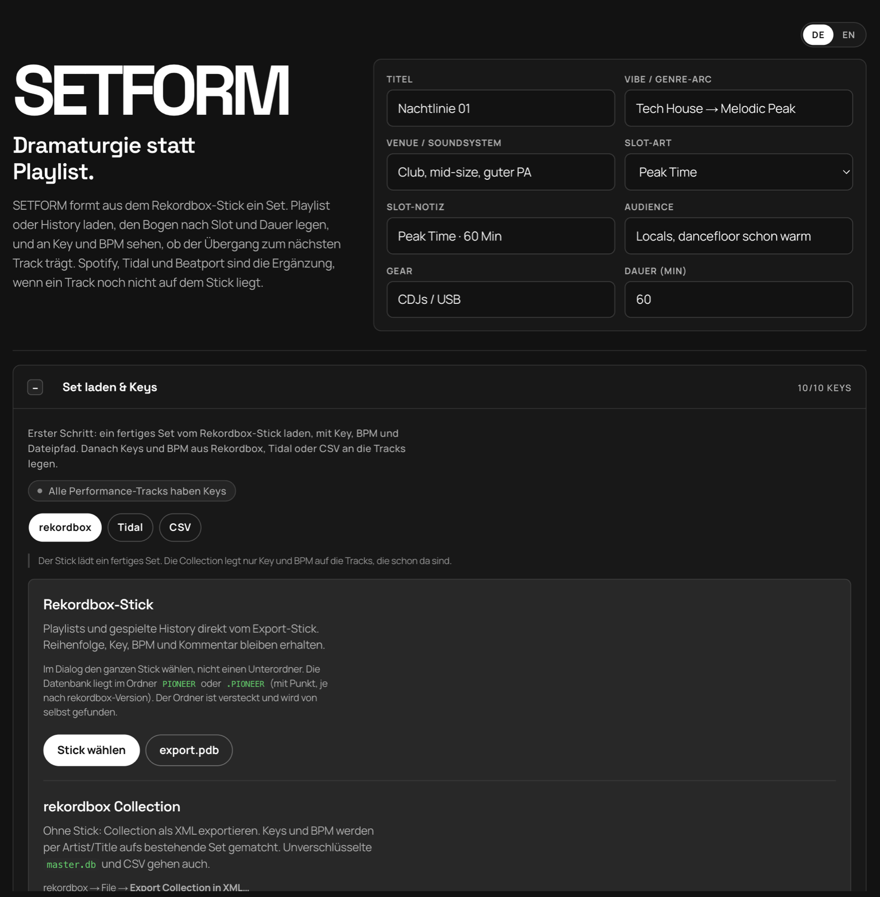
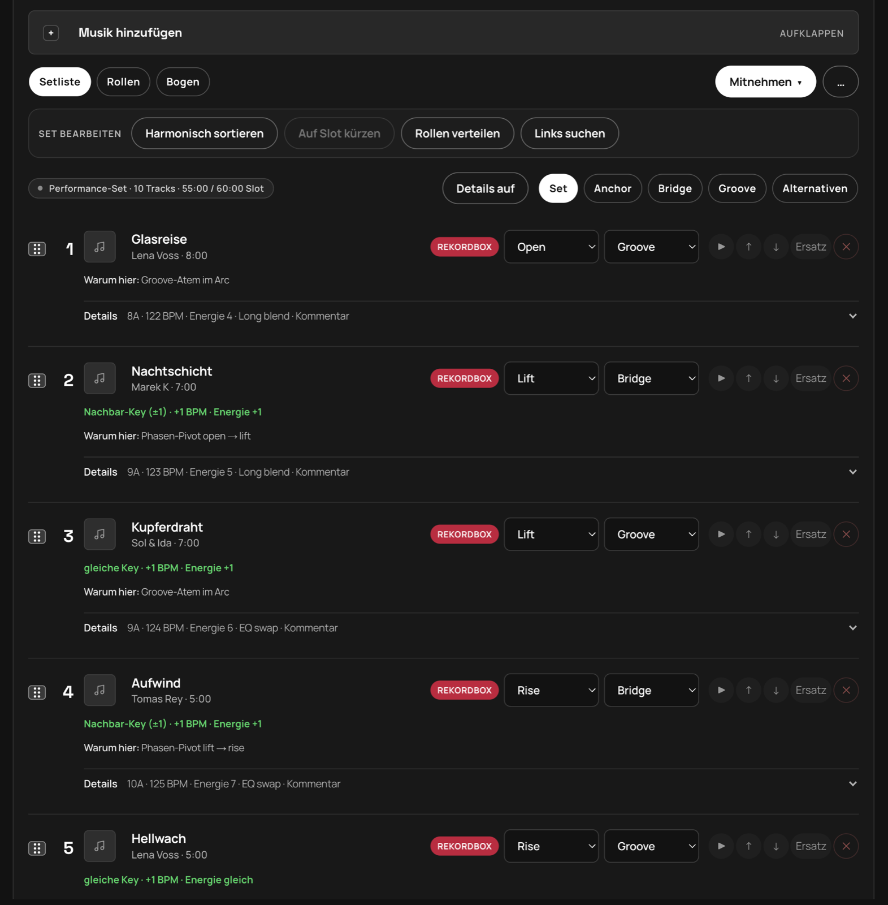
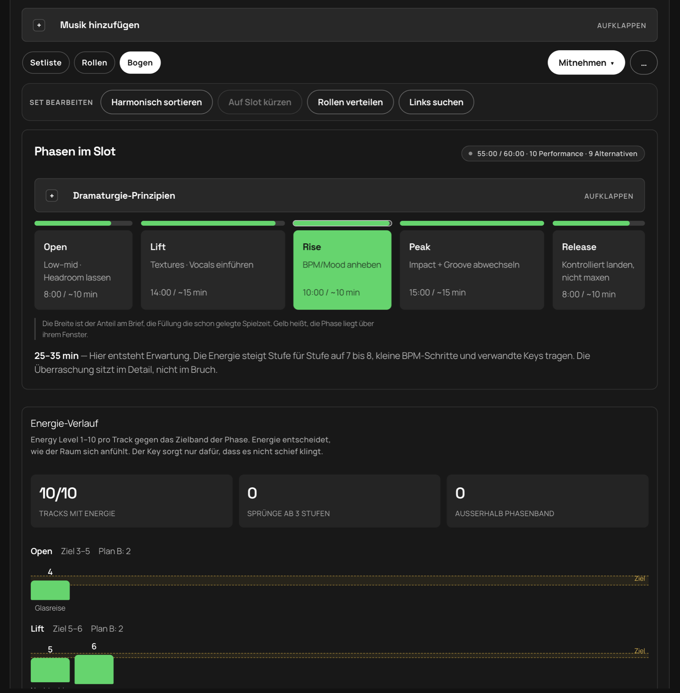
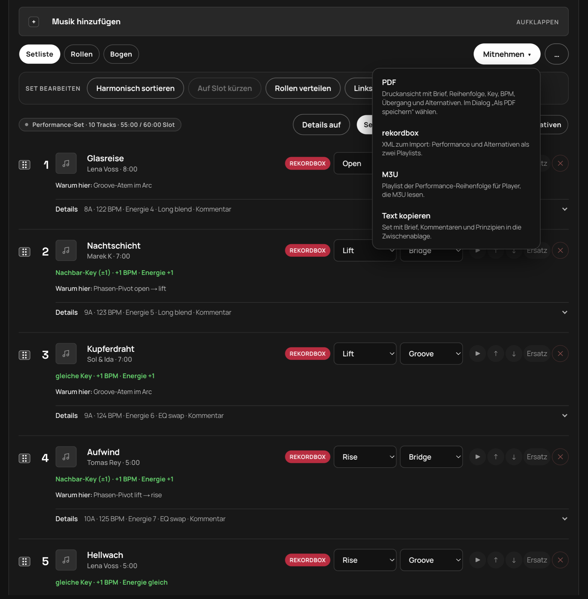

# SETFORM

**Deutsch** · [English](README.md)

**Version 2.5.0** · Dramaturgie statt Playlist.

SETFORM bereitet DJ-Sets für rekordbox vor. Du lädst Playlist oder History vom Export-Stick (oder eine Collection-XML), legst den Bogen nach Slot und Dauer, prüfst Energie, Key und BPM und nimmst das Set als rekordbox-XML, PDF, M3U oder Text mit. Die Logik folgt Mixed In Key: erst Energie, dann Key, dann BPM. Der Ablauf folgt dem [DJ.Studio Prep-Workflow](https://dj.studio/blog/dj-set-preparation#crafting-a-dj-set-that-feels-right-advanced-tips): Brief → Set bauen → Transitions → Export.

> Die Screenshots zeigen ein Beispielset mit erfundenen Titeln. Die App gibt es auf Deutsch und Englisch, oben rechts schaltest du mit **DE / EN** um. Beim ersten Start richtet sie sich nach der Sprache des Browsers.

## So läuft ein Set mit rekordbox

1. **Brief:** Titel, Vibe, Venue, Slot-Art und Dauer.
2. **Aus rekordbox laden:** Stick (`export.pdb`) oder Collection-XML.
3. **Set bauen:** Phasen und Rollen prüfen, von Hand ändern oder automatisch verteilen.
4. **Zurück nach rekordbox:** Export als XML, Performance und Alternativen als zwei Playlists.

## 1. Aus rekordbox laden



**Rekordbox-Stick.** Im Dialog den ganzen Stick wählen, nicht einen Unterordner. SETFORM findet die Datenbank selbst, auch im versteckten Ordner `PIONEER` oder `.PIONEER` (je nach rekordbox-Version). Gelesen werden Playlists und die gespielte History. Reihenfolge, Key, BPM und Kommentar bleiben erhalten, Dateien vom Stick lassen sich direkt vorhören. Wer nur die Datenbank hat, wählt `export.pdb`.

**Collection ohne Stick.** In rekordbox unter *File → Export Collection in XML…* exportieren und laden. Key und BPM werden per Artist und Titel auf die Tracks im Set gelegt. Unverschlüsselte `master.db` und CSV gehen ebenfalls. Nach dem Import sucht die **Bibliothek** durch alle Tracks, und „Erneut matchen“ füllt fehlende Keys nach.

**Energie.** Der Energy Level (1–10) kommt aus Mixed In Key. SETFORM liest ihn aus dem rekordbox-Kommentar (zum Beispiel `7A - Energy 6`), aus der Collection-XML, aus einer CSV-Spalte `Energy` oder von Hand.

## 2. Setliste



Jeder Track zeigt die Quelle (rekordbox), Phase und Rolle. Darunter stehen Key, BPM und Energie, der Übergang zum Vorgänger („Nachbar-Key (±1) · +1 BPM · Energie +1“) und die Begründung („Warum hier“). Die Reihenfolge änderst du per Ziehen oder mit den Pfeilen, „Ersatz“ tauscht einen Titel aus.

**Set bearbeiten**
- **Harmonisch sortieren:** ordnet innerhalb der Phasen nach Camelot-Key und BPM
- **Auf Slot kürzen:** behält pro Phase die Tracks, deren Energie ins Band passt; der Rest wandert unter Alternativen
- **Rollen verteilen:** Anchor auf den stärksten Peak-Tracks und den Schluss, Bridge bei Phasenwechsel, Key-Clash, BPM- oder Energie-Sprung, sonst Groove
- **Spotify-Links suchen:** sucht zu Tracks ohne Link einen Spotify-Treffer, damit du sie im Set vorhören kannst (braucht die Spotify-Zugangsdaten, siehe Setup). Der rekordbox-Export bleibt davon unberührt.

## 3. Rollen und Plan B


Jeder Track hat eine Phase (Open → Lift → Rise → Peak → Release) und eine Rolle:

| Rolle | Aufgabe |
|---|---|
| **Anchor** | Crowd-Connector, Signature-Track |
| **Bridge** | Pivot zwischen Phasen: Key, BPM, Energie |
| **Groove** | Atem zwischen den Peaks |
| **Alternativen** | Plan B, wenn der Floor dreht |

Titel lassen sich zwischen den Spalten ziehen. **Plan B** verlangt pro Phase mindestens zwei passende Alternativen. Eine Alternative zählt für die Phase, die du bei „Ersatz für“ wählst, solange ihre Energie ins Band der Phase passt. Sonst steht der Grund auf der Karte. „Lücken füllen“ nimmt Vorschläge aus deiner rekordbox-Bibliothek, die nach Energie, Key und BPM zu den Tracks der Phase passen.

## 4. Bogen



Der Bogen zeigt, wie die Phasen den Slot füllen (grün passt, gelb liegt über dem Fenster) und wie die Energie jedes Tracks zum Zielband der Phase steht. Sprünge ab drei Stufen werden markiert. Ein Key-Clash lässt sich nicht durch gleiche Energie und BPM ausgleichen.

| Phase | Energie-Ziel |
|---|---|
| Open | 3–5 |
| Lift | 5–6 |
| Rise | 6–8 |
| Peak | 8–10 |
| Release | 4–6 |

## 5. Zurück nach rekordbox



Das Menü **Mitnehmen** exportiert:

- **Auf Stick schreiben:** legt das Set als Playlist `SETFORM - <Titel>` und die Alternativen daneben als `SETFORM - <Titel> Alternativen` in die `export.pdb`. Chrome, Edge oder die Desktop-App. Derselbe Stick wird gemerkt: nach einem Neustart reicht „Stick verbinden“, Schreiben braucht ihn nicht noch einmal. Nur Tracks, die schon auf dem Stick liegen, werden geschrieben; ähnliche Titel (Remix, Original Mix) fragt SETFORM nach, bevor sie mitkommen. Liegt das Set schon da, aktualisiert „Aktualisieren“ es über das letzte Backup und schreibt neu. Vor jedem Schreiben kopiert SETFORM das Original nach `SETFORM-Backup/` (die drei neuesten Sicherungen bleiben) und prüft die Kopie. Danach wird die Datenbank gelesen und verifiziert; schlägt das fehl, kommt der alte Stand zurück. Zusätzlich liegen XML und M3U im Ordner `SETFORM` auf dem Stick. Nach dem Laden und Schreiben prüft SETFORM, ob der Player die Library finden kann: liegt eine veraltete `exportLibrary.db` (OneLibrary) daneben, legt „Für Player vorbereiten“ sie nach `SETFORM-Backup`, damit CDJ-3000, XDJ-XZ und ältere `export.pdb` lesen; „Stick auswerfen“ leert den Cache per `diskutil`. CDJ-3000X, XDJ-AZ und OPUS-QUAD brauchen weiter rekordbox, die verschlüsselte OneLibrary kann SETFORM nicht schreiben. Die rekordbox-Bibliothek auf dem Rechner wird nie angefasst. Erst an einem Ersatz- oder kopierten Stick ausprobieren, und prüfen, ob der Player die Playlist zeigt.
- **rekordbox-XML:** gespeichert als `SETFORM-rekordbox.xml`. In rekordbox einmal *Einstellungen → Erweitert → Datenbank → rekordbox xml* auf diese Datei setzen; die Playlist erscheint dann links unter *rekordbox xml*, Rechtsklick → *Playlist importieren*. Performance und Alternativen kommen als zwei Playlists.
- **PDF:** Druckansicht mit Brief, Reihenfolge, Key, BPM, Übergang und Alternativen
- **M3U:** Playlist der Performance-Reihenfolge, mit dem Namen der Alternativen-Playlist auf dem Stick
- **Text kopieren:** Set mit Brief, Kommentaren und Alternativen

Der Brief und das Set lassen sich unter **Verbindungen & Setups** als Setup speichern, wieder laden oder als JSON sichern.

## Weitere Quellen

rekordbox ist der Hauptweg. Fehlen Keys, ergänzen Tidal (Key und BPM aus dem Catalog per ISRC), CSV oder Paste sie. Titel, die noch nicht in rekordbox liegen, kommen per Link von Spotify, Tidal, Beatport oder SoundCloud ins Set. Bei Beatport und SoundCloud ist kein Login nötig, der Titel kommt aus der Adresse, Key und BPM trägst du von Hand ein oder holst sie über rekordbox.

## Setup

1. Optional, nur für Spotify- und Tidal-Funktionen: Spotify Developer App anlegen und **Web API** aktivieren. Für rekordbox allein ist das nicht nötig.
2. Redirect URI **exakt** eintragen:
   `http://127.0.0.1:4317/api/auth/callback`
   Tidal-Login zusätzlich: `http://127.0.0.1:4317/api/auth/tidal/callback`
3. Dich selbst als User der App hinzufügen (Development Mode)
4. Zugangsdaten unter **Einstellungen** in der App eintragen (die App schreibt sie nach `.env.local`) oder die Datei selbst anlegen:

```bash
SPOTIFY_CLIENT_ID=…
SPOTIFY_CLIENT_SECRET=…
SPOTIFY_REDIRECT_URI=http://127.0.0.1:4317/api/auth/callback

# Optional — Keys/BPM aus dem Tidal Catalog (developer.tidal.com)
TIDAL_CLIENT_ID=…
TIDAL_CLIENT_SECRET=…
```

5. Install & run:

```bash
npm install
npm run dev
```

Entwicklung: [http://127.0.0.1:4327](http://127.0.0.1:4327). Die Desktop-App bleibt auf Port 4317.

## Sprachen

Oberfläche, API-Antworten und Exporte (PDF, Text, Kommentare in der rekordbox-XML) folgen der gewählten Sprache. Die Wahl liegt im Browser (`setform-lang`). Alle Texte stehen in [`src/lib/i18n/messages`](src/lib/i18n/messages). Die deutsche Datei steht vorn, die englische muss jeden Schlüssel liefern, sonst scheitert TypeScript. Ein Test prüft, dass beide Sprachen dieselben Schlüssel und Platzhalter haben.

## Tests

```bash
npm test
```

Läuft mit dem eingebauten Node-Testrunner. Die Hooks in [`scripts/test-hooks.mjs`](scripts/test-hooks.mjs) lösen den `@/`-Alias und Imports ohne Endung auf. Getestet sind Energie, Camelot-Regeln, Slot-Kürzen, Ersatz-Ranking, Plan B, Export, der Stick-Import und die Sprachdateien.

## Desktop (Mac, Windows, Linux)

Die App liegt in [`desktop`](desktop/README.md). `npm start` öffnet das Fenster. `npm run dist` packt sie für das aktuelle System. Ein Git-Tag `v*` baut auf GitHub Mac (Apple Silicon und Intel), Windows und Linux und legt die Dateien ins [Release](https://github.com/ChrisEdS/setform/releases).

Jede Installation braucht für Spotify und Tidal eine eigene Developer-App, rekordbox geht ohne. Die Keys stehen in `.env.local` oder, in der gepackten App, in den Anwendungsdaten unter `.env`. Vorlage: [`.env.example`](.env.example).

### Installer öffnen

Die aktuellen Pakete sind noch nicht signiert. macOS markiert einen Browser-Download mit Quarantäne und meldet dann „SETFORM.app is damaged and can’t be opened“. Die Datei ist nicht beschädigt.

Nach dem Entpacken im Terminal, oder `desktop/scripts/unquarantine.sh`:

```bash
xattr -dr com.apple.quarantine /Applications/SETFORM.app
```

Den Pfad an den Ort anpassen, an dem die App liegt. Danach öffnet ein Doppelklick die App. Alternativ: Rechtsklick auf SETFORM → Öffnen, und im Dialog noch einmal Öffnen.

Windows zeigt einen SmartScreen-Hinweis. Über „Trotzdem ausführen“ startet die Installation. Linux startet die AppImage direkt.

Sobald die Apple- und Windows-Zertifikate als GitHub-Secrets liegen, signiert der nächste Release. Auf dem Mac entfällt der Quarantäne-Schritt dann. Die Schritte stehen in [`desktop/README.md`](desktop/README.md).

## Lizenz

MIT, siehe [LICENSE](LICENSE).
