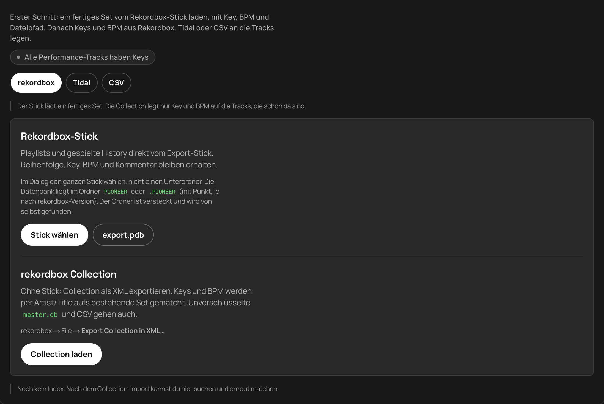
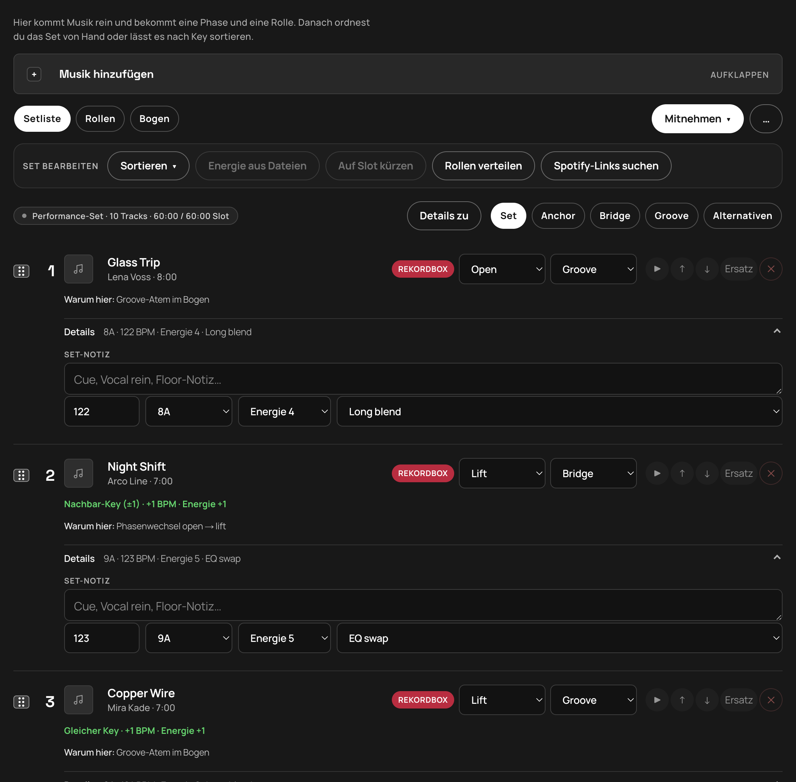
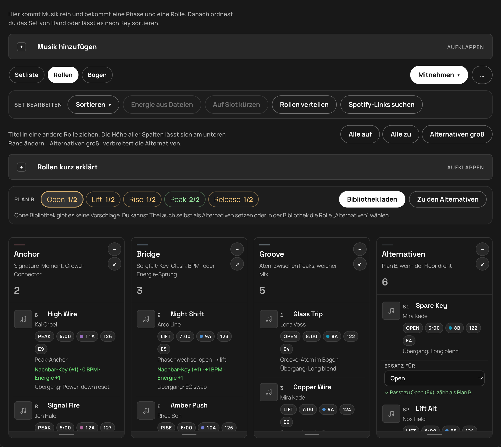
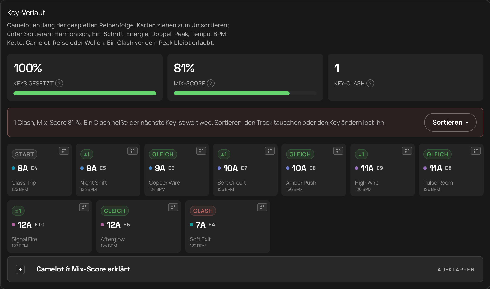
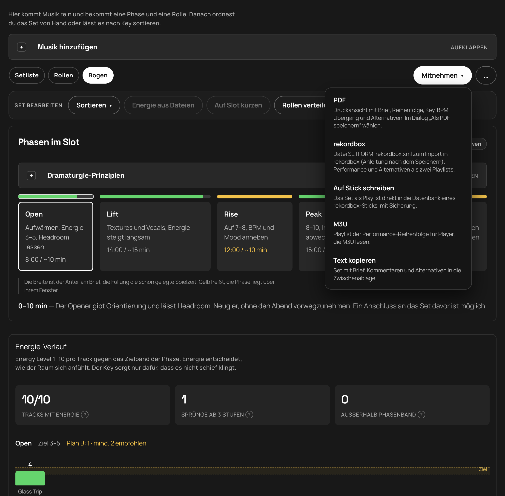

# SETBUILDER

**Deutsch** · [English](README.md)

**Version 3.1.2** · Dramaturgie statt Playlist.

SETBUILDER bereitet DJ-Sets für rekordbox vor. Du lädst Playlist oder History vom Export-Stick (oder eine Collection-XML), legst den Bogen nach Slot und Dauer, prüfst Energie, Key und BPM und nimmst das Set als rekordbox-XML, PDF, M3U oder Text mit. Die Logik folgt Mixed In Key: erst Energie, dann Key, dann BPM. Der Ablauf folgt dem [DJ.Studio Prep-Workflow](https://dj.studio/blog/dj-set-preparation#crafting-a-dj-set-that-feels-right-advanced-tips): Brief → Set bauen → Transitions → Export.

**Highlights**
- ⚡ **Energie aus Dateien** — Kein Mixed In Key Level? Stick-MP3s im Browser analysieren, Energy in ID3 schreiben (Audio unangetastet), Tags in rekordbox neu laden
- 🔑 **Key-Verlauf** — Camelot entlang des Sets mit Mix-Score, Clash-Badges, Drag und Mixed-In-Key-Sortierungen
- 🎚️ **Bogen & Energie** — Phasen Open→Release gegen Zielbänder; Sprünge und Ausreißer sichtbar
- 💾 **Stick-Rundreise** — Aus `export.pdb` laden, Set als Playlist zurückschreiben, Player-Check vor dem Gig
- 🛟 **Plan B** — Rollen und Alternativen pro Phase, wenn der Floor dreht

> Die Screenshots zeigen ein Beispielset mit erfundenen Titeln. Die App gibt es auf Deutsch und Englisch, oben rechts schaltest du mit **DE / EN** um. Beim ersten Start richtet sie sich nach der Sprache des Browsers.

> **Vor dem Gig:** Stick immer am echten Player testen (Playlist sichtbar, Tracks spielbar). Backup behalten — SETBUILDER schreibt in `export.pdb` und legt Kopien unter `SETBUILDER-Backup/` ab, für deine Medien bist du selbst verantwortlich. Keine Garantie. Works on my machine. :)

## So läuft ein Set mit rekordbox

1. **Brief:** Titel, Vibe, Venue, Slot-Art und Dauer.
2. **Aus rekordbox laden:** Stick (`export.pdb`) oder Collection-XML.
3. **Set bauen:** Phasen und Rollen prüfen, von Hand ändern oder automatisch verteilen.
4. **Zurück nach rekordbox:** Export als XML, Performance und Alternativen als zwei Playlists.

## 1. Aus rekordbox laden



**Rekordbox-Stick.** Am besten **Stick wählen** (Chrome / Edge / Desktop) für die Volume-Wurzel, oder `PIONEER` / `PIONEER/rekordbox`. Wenn der Ordner-Dialog fehlschlägt oder hängt: **export.pdb** (`PIONEER/rekordbox/export.pdb` oder `.PIONEER/…`) — der zuverlässigste Weg. Nicht den ganzen USB mit allen Musikdateien wählen, das kann ewig dauern. SETBUILDER findet die Datenbank selbst, auch im versteckten Ordner `PIONEER` oder `.PIONEER`. Gelesen werden Playlists und die gespielte History. Reihenfolge, Key und BPM bleiben erhalten; der Energy Level wird aus dem rekordbox-Kommentar gelesen, wenn Mixed In Key ihn dort geschrieben hat. Dateien vom Stick lassen sich direkt vorhören. Während Dialog, Dateiliste und Datenbank-Lesen steht ein Status.

**Player-Check.** Nach dem Wählen zeigt ein kurzer Strip ein Urteil und eine Primäraktion (Für Player vorbereiten, Auswerfen oder rekordbox öffnen). Details (Ordner, Datenbank, OneLibrary, SETBUILDER-Playlists) liegen hinter einem Toggle. Grün heißt: Device-Library-Player können den Stick nutzen; Amber heißt: es fehlt noch ein Schritt.

**Collection ohne Stick.** In rekordbox unter *File → Export Collection in XML…* exportieren und laden. Key und BPM werden per Artist und Titel auf die Tracks im Set gelegt. Unverschlüsselte `master.db` und CSV gehen ebenfalls. Nach dem Import sucht die **Bibliothek** durch alle Tracks, und „Erneut matchen“ füllt fehlende Keys nach.

**Energie.** Der Energy Level (1–10) kommt aus Mixed In Key. SETBUILDER liest ihn aus dem rekordbox-Kommentar (zum Beispiel `7A - Energy 6`, `Energie 6`), aus Grouping / Label / Remixer in der Collection-XML oder CSV (`Energy` / `Energie`), aus einer nackten `6` oder `E8` in diesen Feldern, oder von Hand in der Setliste. Der USB-`export.pdb` hat Kommentare, aber kein Grouping — in rekordbox Tags neu laden und die Collection-XML laden, wenn die Energie leer bleibt.

**Set-Notiz.** In den Track-Details ist die **Set-Notiz** nur für dieses Set in SETBUILDER (Cue, Floor). Sie ist nicht der MP3-/rekordbox-Kommentar und wird nicht zurück in ID3-Tags geschrieben.

**Energie aus Stick-Dateien.** Unter **Set bearbeiten** analysiert **Energie aus Dateien** Tracks mit Stick-Pfad (Chrome / Edge / Desktop). SETBUILDER setzt `energyLevel` im Draft und schreibt bei MP3 ID3 `TXXX EnergyLevel` plus `Energy N` in den Dateikommentar — die Audiodaten bleiben unverändert; Key, BPM und die Set-Notiz bleiben unangetastet. Beim erneuten Laden mit verbundenem Stick liest SETBUILDER fehlende Energie wieder aus den MP3-Tags — `TXXX EnergyLevel` / `Energy`, Kommentare mit `Energy N`, sowie Grouping / Remixer / Label (`export.pdb` kennt sie erst, wenn rekordbox die Tags neu geladen hat). Danach in rekordbox die Tags neu laden, damit Player und Bibliothek die Werte sehen. Die `master.db` auf dem Rechner bleibt unangetastet. Die Analyse nutzt [essentia.js](https://github.com/MTG/essentia.js) (AGPL-3.0) nur im Browser; siehe [THIRD_PARTY.md](THIRD_PARTY.md).

## 2. Setliste



Jeder Track zeigt die Quelle (rekordbox), Phase und Rolle. Darunter stehen Key, BPM und Energie, der Übergang zum Vorgänger („Nachbar-Key (±1) · +1 BPM · Energie +1“) und die Begründung („Warum hier“). Die Reihenfolge änderst du per Ziehen oder mit den Pfeilen, „Ersatz“ tauscht einen Titel aus.

**Set bearbeiten**
- **Sortieren:** nur innerhalb einer Phase (Alternativen bleiben am Ende). Dasselbe Menü in der Setliste und im Key-Verlauf. Ändert sich nichts, sagt SETBUILDER das — oft fehlen Key/Energie/BPM, oder eine Phase hat nur ein bis zwei Tracks.

  | Technik | Was sie macht |
  |---|---|
  | **Harmonisch** | Verwandte Camelot-Keys, weiche Energie, kleine BPM-Schritte |
  | **Ein-Schritt** | Mixed In Key: Energie ±1 pro Übergang |
  | **Energie-Welle** | Steigt Open→Peak, fällt im Release |
  | **Doppel-Peak** | Aufbauen, kurz −2, wieder hoch (Rise/Peak) |
  | **Tempo aufbauen** | BPM-Rampe mit der Phase |
  | **BPM-Kette** | Im ±2–4-Pocket bleiben |
  | **Camelot-Reise** | Im Uhrzeigersinn ums Wheel |
  | **Wellen** | Im Peak wechseln Groove und Impact |

- **Energie aus Dateien:** berechnet den Energy Level aus Stick-Audio (Essentia), setzt ihn im Draft und schreibt Energy-Tags in die MP3 auf dem Stick (Chrome / Edge / Desktop). Die Set-Notiz bleibt unangetastet. Danach Tags in rekordbox neu laden.
- **Auf Slot kürzen:** behält pro Phase die Tracks, deren Energie ins Band passt; der Rest wandert unter Alternativen
- **Rollen verteilen:** Anchor auf den stärksten Peak-Tracks und den Schluss, Bridge bei Phasenwechsel, Key-Clash, BPM- oder Energie-Sprung, sonst Groove
- **Spotify-Links suchen:** sucht zu Tracks ohne Link einen Spotify-Treffer, damit du sie im Set vorhören kannst (braucht die Spotify-Zugangsdaten, siehe Setup). Der rekordbox-Export bleibt davon unberührt.

## 3. Rollen und Plan B



Jeder Track hat eine Phase (Open → Lift → Rise → Peak → Release) und eine Rolle:

| Rolle | Aufgabe |
|---|---|
| **Anchor** | Crowd-Connector, Signature-Track |
| **Bridge** | Pivot zwischen Phasen: Key, BPM, Energie |
| **Groove** | Atem zwischen den Peaks |
| **Alternativen** | Plan B, wenn der Floor dreht |

Titel lassen sich zwischen den Spalten ziehen. **Plan B** verlangt pro Phase mindestens zwei passende Alternativen. Eine Alternative zählt für die Phase, die du bei „Ersatz für“ wählst, solange ihre Energie ins Band der Phase passt. Sonst steht der Grund auf der Karte. „Lücken füllen“ nimmt Vorschläge aus deiner rekordbox-Bibliothek, die nach Energie, Key und BPM zu den Tracks der Phase passen.

## 4. Bogen



Der Bogen zeigt, wie die Phasen den Slot füllen (aktive Phase hervorgehoben; gelb heißt über dem Fenster) und wie die Energie jedes Tracks zum Zielband der Phase steht. Sprünge ab drei Stufen werden markiert.

**Key-Verlauf** zeigt Camelot entlang der gespielten Reihenfolge. Jede Karte hat ein kurzes Relationen-Badge (Gleich, ±1, Clash, …), den Key, Energie wenn bekannt und BPM. Karten ziehen zum Umsortieren; **Sortieren** für die Techniken oben. Drei Kacheln mit **?** erklären die Zahlen:
- **Keys gesetzt** — Anteil der Performance-Tracks mit Camelot-Key
- **Mix-Score** — Mittel aller Übergänge (Key und Energie zu gleichen Teilen, kleine BPM-Korrektur). Über ~75 % ist weich, unter ~50 % knallt es oft
- **Clashes** — Übergänge, deren Keys auf dem Camelot-Wheel weit auseinanderliegen

Sortieren, Ziehen oder Key/Energie in der Setliste ändern die Zahlen. Ein Key-Clash lässt sich nicht allein durch gleiche Energie und BPM ausgleichen.

| Phase | Energie-Ziel |
|---|---|
| Open | 3–5 |
| Lift | 5–6 |
| Rise | 6–8 |
| Peak | 8–10 |
| Release | 4–6 |

## 5. Zurück nach rekordbox



Das Menü **Mitnehmen** exportiert:

- **Auf Stick schreiben:** legt das Set als Playlist `SETBUILDER - <Titel>` und die Alternativen daneben als `SETBUILDER - <Titel> Alternativen` in die `export.pdb`. Chrome, Edge oder die Desktop-App. Derselbe Stick wird gemerkt: nach einem Neustart reicht „Stick verbinden“, Schreiben braucht ihn nicht noch einmal. Nur Tracks, die schon auf dem Stick liegen, werden geschrieben; ähnliche Titel (Remix, Original Mix) fragt SETBUILDER nach, bevor sie mitkommen. Liegt das Set schon da, aktualisiert „Aktualisieren“ es über das letzte Backup und schreibt neu. Vor jedem Schreiben kopiert SETBUILDER das Original nach `SETBUILDER-Backup/` (die drei neuesten Sicherungen bleiben) und prüft die Kopie. Danach wird die Datenbank gelesen und verifiziert; schlägt das fehl, kommt der alte Stand zurück. Zusätzlich liegen XML und M3U im Ordner `SETBUILDER` auf dem Stick. Der Stick-Health-Strip (siehe oben) bietet „Für Player vorbereiten“, wenn eine veraltete `exportLibrary.db` (OneLibrary) die Playlists auf CDJ-3000 / XDJ-XZ verdecken würde, und „Auswerfen“ für den OS-Cache. CDJ-3000X, XDJ-AZ und OPUS-QUAD brauchen weiter rekordbox — die verschlüsselte OneLibrary kann SETBUILDER nicht schreiben. Die rekordbox-Bibliothek auf dem Rechner (`master.db`) wird nie angefasst. Erst an einem Ersatz- oder kopierten Stick üben; **nie mit ungetestetem Stick zum Gig**.
- **rekordbox-XML:** gespeichert als `SETBUILDER-rekordbox.xml`. In rekordbox einmal *Einstellungen → Erweitert → Datenbank → rekordbox xml* auf diese Datei setzen; die Playlist erscheint dann links unter *rekordbox xml*, Rechtsklick → *Playlist importieren*. Performance und Alternativen kommen als zwei Playlists.
- **PDF:** Druckansicht mit Brief, Reihenfolge, Key, BPM, Übergang und Alternativen
- **M3U:** Playlist der Performance-Reihenfolge, mit dem Namen der Alternativen-Playlist auf dem Stick
- **Text kopieren:** Set mit Brief, Set-Notizen und Alternativen

Der Brief und das Set lassen sich unter **Verbindungen & Setups** als Setup speichern, wieder laden oder als JSON sichern.

## Weitere Quellen

rekordbox ist der Hauptweg. Fehlen Keys, ergänzen Tidal (Key und BPM aus dem Catalog per ISRC), CSV oder Paste sie. Titel, die noch nicht in rekordbox liegen, kommen per Link von Spotify, Tidal, Beatport oder SoundCloud ins Set. Bei Beatport und SoundCloud ist kein Login nötig, der Titel kommt aus der Adresse, Key und BPM trägst du von Hand ein oder holst sie über rekordbox.

## Setup

1. Optional, nur für Spotify- und Tidal-Funktionen: Spotify Developer App anlegen und **Web API** aktivieren. Für rekordbox allein ist das nicht nötig.
2. Redirect URI **exakt** eintragen:
   `http://127.0.0.1:4317/api/auth/callback`
   Tidal-Login zusätzlich: `http://127.0.0.1:4317/api/auth/tidal/callback`
3. Dich selbst als User der App hinzufügen (Development Mode)
4. Zugangsdaten unter **Einstellungen** in der App eintragen (die App schreibt sie nach `.env.local`) oder die Datei selbst anlegen:

```bash
SPOTIFY_CLIENT_ID=…
SPOTIFY_CLIENT_SECRET=…
SPOTIFY_REDIRECT_URI=http://127.0.0.1:4317/api/auth/callback

# Optional — Keys/BPM aus dem Tidal Catalog (developer.tidal.com)
TIDAL_CLIENT_ID=…
TIDAL_CLIENT_SECRET=…
```

5. Install & run:

```bash
npm install
npm run dev
```

Entwicklung: [http://127.0.0.1:4327](http://127.0.0.1:4327). Die Desktop-App bleibt auf Port 4317.

## Sprachen

Oberfläche, API-Antworten und Exporte (PDF, Text, Kommentare in der rekordbox-XML) folgen der gewählten Sprache. Die Wahl liegt im Browser (`setbuilder-lang`). Alle Texte stehen in [`src/lib/i18n/messages`](src/lib/i18n/messages). Die deutsche Datei steht vorn, die englische muss jeden Schlüssel liefern, sonst scheitert TypeScript. Ein Test prüft, dass beide Sprachen dieselben Schlüssel und Platzhalter haben.

## Tests

```bash
npm test
```

Läuft mit dem eingebauten Node-Testrunner. Die Hooks in [`scripts/test-hooks.mjs`](scripts/test-hooks.mjs) lösen den `@/`-Alias und Imports ohne Endung auf. Getestet sind Energie-Parsing, Openkey-Energieformel und ID3-Schreiben (EnergyLevel + Kommentar, Audio unverändert, Serato-GEOB bleibt), Camelot / Mix-Score, Set-Sortierungen, Slot-Kürzen, Ersatz-Ranking, Plan B, Export (BPM, Notizen), Stick-Import / Schreiben / Health / Session und die Sprachdateien.

## Desktop (Mac, Windows, Linux)

Die App liegt in [`desktop`](desktop/README.md). `npm start` öffnet das Fenster. `npm run dist` packt sie für das aktuelle System. Ein Git-Tag `v*` baut auf GitHub Mac (Apple Silicon und Intel), Windows und Linux und legt die Dateien ins [Release](https://github.com/ChrisEdS/setbuilder/releases).

Jede Installation braucht für Spotify und Tidal eine eigene Developer-App, rekordbox geht ohne. Die Keys stehen in `.env.local` oder, in der gepackten App, in den Anwendungsdaten unter `.env`. Vorlage: [`.env.example`](.env.example).

### Installer öffnen

Die aktuellen Pakete sind noch nicht signiert. macOS markiert einen Browser-Download mit Quarantäne und meldet dann „SETBUILDER.app is damaged and can’t be opened“. Die Datei ist nicht beschädigt.

Nach dem Entpacken im Terminal, oder `desktop/scripts/unquarantine.sh`:

```bash
xattr -dr com.apple.quarantine /Applications/SETBUILDER.app
```

Den Pfad an den Ort anpassen, an dem die App liegt. Danach öffnet ein Doppelklick die App. Alternativ: Rechtsklick auf SETBUILDER → Öffnen, und im Dialog noch einmal Öffnen.

Windows zeigt einen SmartScreen-Hinweis. Über „Trotzdem ausführen“ startet die Installation. Linux startet die AppImage direkt.

Sobald die Apple- und Windows-Zertifikate als GitHub-Secrets liegen, signiert der nächste Release. Auf dem Mac entfällt der Quarantäne-Schritt dann. Die Schritte stehen in [`desktop/README.md`](desktop/README.md).

## Unterstützen

SETBUILDER bleibt kostenlos und offen — inklusive **Energie aus Dateien**, Key-Verlauf und Stick-Schreiben. Wenn es bei der Set-Vorbereitung hilft, kannst du das Projekt [auf GitHub sponsern](https://github.com/sponsors/ChrisEdS).

## Lizenz

MIT, siehe [LICENSE](LICENSE). Die clientseitige Energie-Analyse nutzt essentia.js (AGPL-3.0); siehe [THIRD_PARTY.md](THIRD_PARTY.md).
