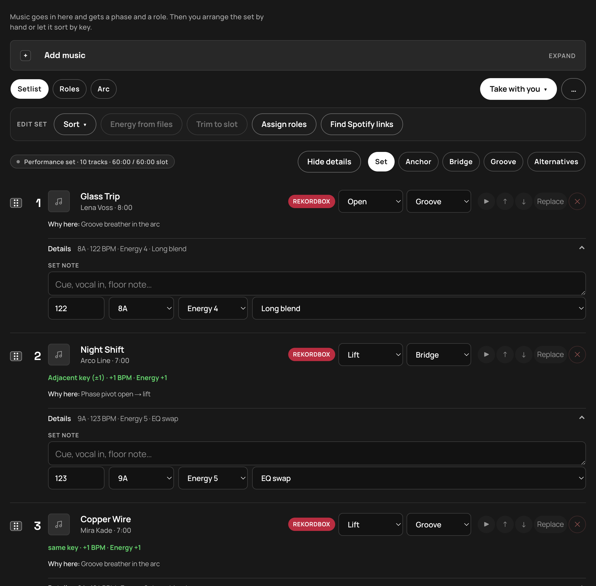
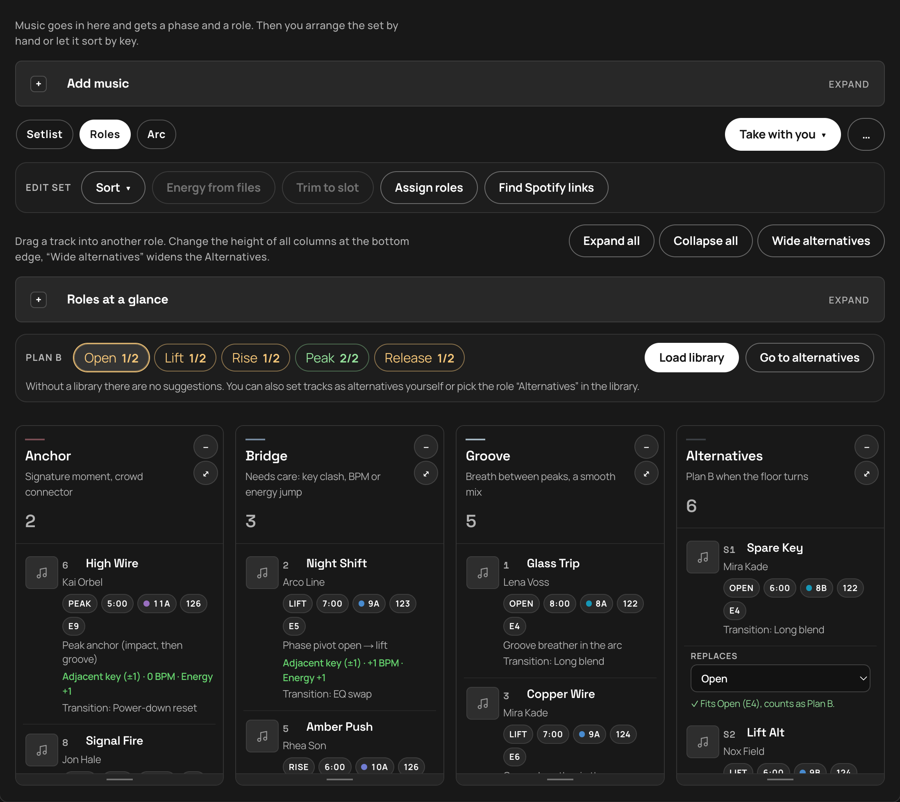
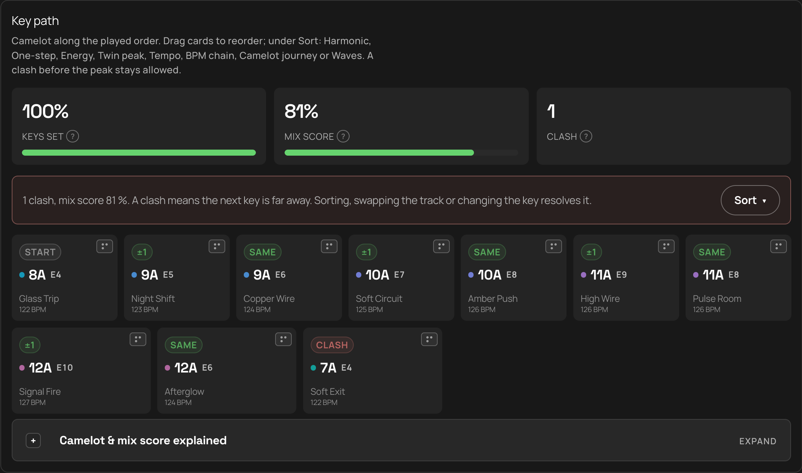
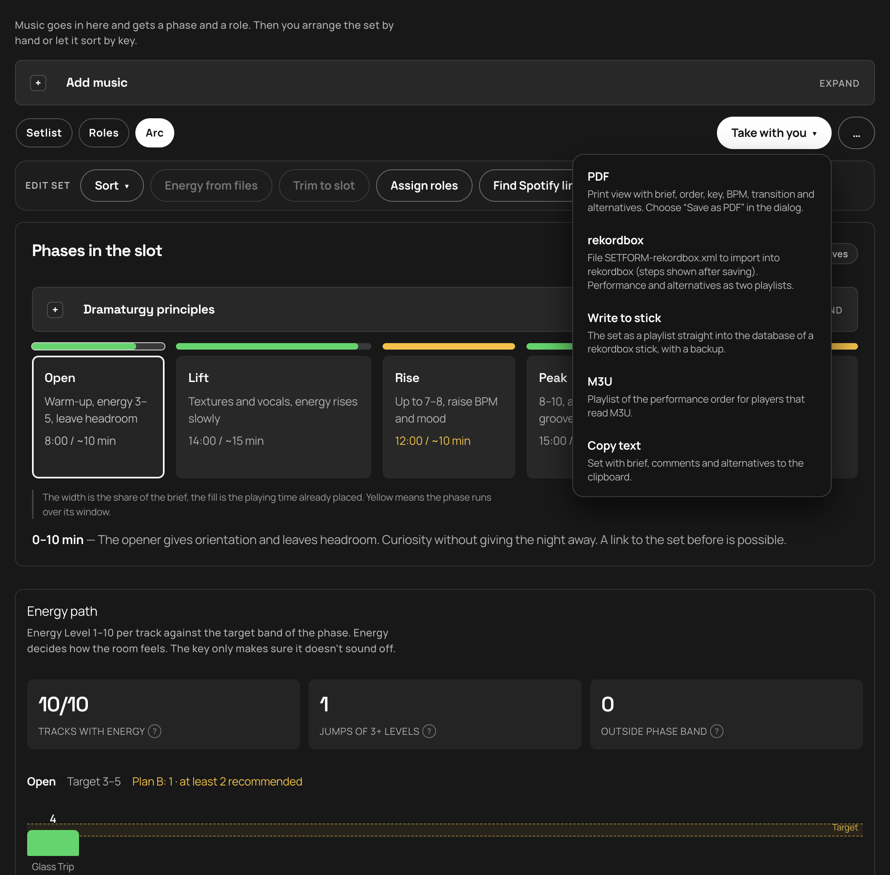

# SETBUILDER

[Deutsch](README.de.md) · **English**

[](https://github.com/sponsors/ChrisEdS)

**Version 3.2.0** · Dramaturgy, not a playlist.

SETBUILDER prepares DJ sets for rekordbox. You load a playlist or history from the export stick (or a collection XML), lay out the arc by slot and duration, check energy, key and BPM, and take the set with you as rekordbox XML, PDF, M3U or text. The logic follows Mixed In Key: energy first, then key, then BPM. The workflow follows the [DJ.Studio prep workflow](https://dj.studio/blog/dj-set-preparation#crafting-a-dj-set-that-feels-right-advanced-tips): brief → build the set → transitions → export.

**Highlights**
- ⚡ **Energy from files** — Missing Mixed In Key levels? Analyze stick MP3s in the browser, write Energy into ID3 (audio untouched), reload tags in rekordbox
- 🔑 **Key path** — Camelot along the set with mix score, clash badges, drag reorder and Mixed In Key–style sorts
- 🎚️ **Arc & energy** — Phases Open→Release against target bands; jumps and outliers called out
- 📌 **Opener & closer** — Pin the first and last performance track; sorts keep them at the ends
- 💾 **Stick round-trip** — Load from `export.pdb`, write the set back as playlist, player check before the gig
- 🛟 **Plan B** — Roles and alternatives per phase when the floor turns

> The screenshots show a sample set with made-up titles. The app comes in English and German. Switch with **DE / EN** at the top right; on first launch it follows your browser language.

> **Before the gig:** Always test the stick on the actual player (playlist visible, tracks playable). Keep a backup — SETBUILDER writes to `export.pdb` and keeps copies under `SETBUILDER-Backup/`, but you are responsible for your media. No warranty. Works on my machine. :)

## How a set works with rekordbox

1. **Brief:** title, vibe, venue, slot type and duration.
2. **Load from rekordbox:** the stick (`export.pdb`) or a collection XML.
3. **Build the set:** check phases and roles, change them by hand or let SETBUILDER assign them.
4. **Back to rekordbox:** export as XML, with the performance and the alternatives as two playlists.

## 1. Load from rekordbox


**Rekordbox stick.** Prefer **Choose stick** (Chrome / Edge / desktop) for the volume root, or pick `PIONEER` / `PIONEER/rekordbox`. If the folder dialog fails or hangs, use **export.pdb** (`PIONEER/rekordbox/export.pdb` or `.PIONEER/…`) — the most reliable path. Avoid selecting the whole USB with every music file; that can stall. SETBUILDER finds the database itself, even in the hidden `PIONEER` or `.PIONEER` folder. It reads playlists and the played history. Order, key and BPM are kept; Energy Level is read from the rekordbox comment when Mixed In Key wrote it there. Files from the stick can be previewed directly. Status text shows while the dialog is open, while files are listed, and while the database is read.

**Player check.** After a stick is chosen, a short strip shows one verdict and one primary action (prepare for player, eject, or open rekordbox). Details (folder, database, OneLibrary, SETBUILDER playlists) sit behind a toggle. Green means Device Library players can use the stick; amber means a step is still needed.

**Collection without a stick.** In rekordbox, export via *File → Export Collection in XML…* and load the file. Key and BPM are matched onto the tracks in the set by artist and title. An unencrypted `master.db` and CSV work too. After the import, the **Library** searches by artist, title, key or stick **playlist** (picker + autocomplete). **Fits after** ranks tracks that can follow a chosen set track; **5 others** pages through more matches.

**Energy.** The Energy Level (1–10) comes from Mixed In Key. SETBUILDER reads it from the rekordbox comment (for example `7A - Energy 6`, `Energie 6`), from Grouping / Label / Remixer in the collection XML or CSV (`Energy` / `Energie`), from a lone `6` or `E8` in those fields, or you set it by hand in the setlist. USB `export.pdb` has comments but not Grouping — reload tags in rekordbox and load the collection XML if energy stays empty.

**Set note.** In the setlist details, **Set note** is only for this set in SETBUILDER (cue, floor). It is not the MP3/rekordbox comment and is not written back into ID3 tags.

**Energy from stick files.** Under **Edit set**, **Energy from files** analyzes tracks that have a stick path (Chrome / Edge / desktop). It sets `energyLevel` in the draft and, for MP3s, writes ID3 `TXXX EnergyLevel` plus `Energy N` in the file comment — audio bytes stay unchanged; key, BPM and the Set note stay untouched. When you load the set again with the stick connected, SETBUILDER re-reads missing energy from MP3 tags — `TXXX EnergyLevel` / `Energy`, comments with `Energy N`, and Grouping / Remixer / Label fields (export.pdb is not updated until rekordbox reloads tags). After writing, reload tags in rekordbox so the player and library see the new values. `master.db` on the computer is never touched. Analysis uses [essentia.js](https://github.com/MTG/essentia.js) (AGPL-3.0) in the browser only; see [THIRD_PARTY.md](THIRD_PARTY.md).

## 2. Setlist



Each track shows its source (rekordbox), phase and role. Controls sit under the title: phase and role on one row, play / move / Replace / **Opener** / **Closer** / remove on the next. Hover any control for a short tip. Below are key, BPM and energy, the transition from the previous track (“Adjacent key (±1) · +1 BPM · Energy +1”) and the reasoning (“Why here”). Change the order by dragging or with the arrows; “Replace” swaps a title.

**Opener & closer.** Pin a performance track as **Opener** (stays first, phase Open) or **Closer** (stays last, phase Release). Extract suggests warm open / release pins; you can change or clear them anytime. Sorting re-applies the pins so they stay at the ends.

**Edit set**
- **Sort:** reorders only inside each phase (Alternatives stay at the end; pinned opener/closer stay first/last overall). Same menu on the setlist and on the Key path. If nothing moves, SETBUILDER says so — often key/energy/BPM are missing, or a phase has only one or two tracks.

  | Technique | What it does |
  |---|---|
  | **Harmonic** | Related Camelot keys, soft energy, small BPM steps |
  | **One-step** | Mixed In Key: energy ±1 per transition |
  | **Energy wave** | Climbs Open→Peak, falls in Release |
  | **Twin peak** | Build, dip ≈−2, climb again (rise/peak) |
  | **Build tempo** | BPM ramp with the phase |
  | **BPM chain** | Stay in the ±2–4 pocket |
  | **Camelot journey** | Clockwise around the wheel |
  | **Waves** | In Peak, groove and impact alternate |

- **Energy from files:** computes Energy Level from stick audio (Essentia), sets it in the draft, and writes ID3 energy tags into MP3s on the stick (Chrome / Edge / desktop). The Set note is not changed. Then reload tags in rekordbox.
- **Trim to slot:** keeps, per phase, the tracks whose energy fits the band; the rest moves to Alternatives
- **Assign roles:** Anchor on the strongest Peak tracks and the closer, Bridge at a phase change, key clash, BPM or energy jump, otherwise Groove
- **Find Spotify links:** looks up a Spotify match for tracks without a link so you can preview them in the set (needs the Spotify credentials, see Setup). Your rekordbox export is unaffected.

## 3. Roles and Plan B



Every track has a phase (Open → Lift → Rise → Peak → Release) and a role:

| Role | Job |
|---|---|
| **Anchor** | Crowd connector, signature track |
| **Bridge** | Pivot between phases: key, BPM, energy |
| **Groove** | Room to breathe between peaks |
| **Alternatives** | Plan B when the floor turns |

Drag titles between the columns. **Plan B** asks for at least two fitting alternatives per phase. An alternative counts for the phase you pick under “Replaces”, as long as its energy fits the phase's band. Otherwise the reason is shown on the card. “Fill gaps” takes suggestions from your rekordbox library that fit the phase's tracks by energy, key and BPM.

## 4. Arc



The arc shows how the phases fill the slot (active phase is highlighted; yellow means over the window) and how each track's energy sits against the phase's target band. Jumps of three levels or more are marked.

**Key path** shows Camelot along the played order. Each card has a short relation badge (Same, ±1, Clash, …), the key, energy when known, and BPM. Drag cards to reorder; use **Sort** for the techniques above. Three stats with a **?** explain the numbers:
- **Keys set** — share of performance tracks with a Camelot key
- **Mix score** — average of every transition (key and energy in equal parts, small BPM correction). Above ~75 % is smooth; below ~50 % often clashes
- **Clashes** — transitions whose keys sit far apart on the Camelot wheel

Sort, drag, or change key/energy in the setlist to move the numbers. A clash can't be bought back with matching energy and BPM alone.

| Phase | Energy target |
|---|---|
| Open | 3–5 |
| Lift | 5–6 |
| Rise | 6–8 |
| Peak | 8–10 |
| Release | 4–6 |

## 5. Back to rekordbox



The **Take with you** menu exports:

- **Write to stick:** adds the set as playlist `SETBUILDER - <title>` and the alternatives next to it as `SETBUILDER - <title> Alternatives` in `export.pdb`. Chrome, Edge or the desktop app. The same stick is remembered: after a restart, “Reconnect stick” is enough, and writing does not ask again. Only tracks already on the stick are written; similar titles (remix, original mix) are offered before they go in. If the set is already there, *Update* restores the last backup and writes the current set. Before every write SETBUILDER copies the original to `SETBUILDER-Backup/` (the three newest backups stay) and checks the copy. After writing, the database is read and verified; if that fails the old state is put back. XML and M3U are also written to the `SETBUILDER` folder on the stick. The stick health strip (see above) offers *Prepare for player* when a stale `exportLibrary.db` (OneLibrary) would hide your playlists on CDJ-3000 / XDJ-XZ, and *Eject* to flush the OS cache. CDJ-3000X, XDJ-AZ and OPUS-QUAD still need rekordbox — SETBUILDER cannot write the encrypted OneLibrary. The rekordbox library on the computer (`master.db`) is never touched. Practice on a spare or copied stick first; **never go to a gig with an untested stick**.
- **rekordbox XML:** saved as `SETBUILDER-rekordbox.xml`. In rekordbox set *Preferences → Advanced → Database → rekordbox xml* to this file once; the playlist then appears under *rekordbox xml* in the left tree, right-click → *Import Playlist*. The performance and the alternatives come as two playlists.
- **PDF:** print view with brief, order, key, BPM, transition and alternatives
- **M3U:** playlist in performance order, naming the alternatives playlist on the stick
- **Copy text:** the set with brief, set notes and alternatives

Under **Connections & setups** you can save the brief and the set as a setup, load it again, or back it up as JSON.

## More sources

rekordbox is the main route. If keys are missing, Tidal (key and BPM from the catalog via ISRC), CSV or paste fill them in. Titles that aren't in rekordbox yet come into the set by link from Spotify, Tidal, Beatport or SoundCloud. Beatport and SoundCloud need no login: the title comes from the address, and you enter key and BPM by hand or get them through rekordbox.

## Setup

1. Optional, only for Spotify and Tidal features: create a Spotify Developer app and enable **Web API**. rekordbox on its own doesn't need this.
2. Enter the redirect URI **exactly**:
   `http://127.0.0.1:4317/api/auth/callback`
   For Tidal login, additionally: `http://127.0.0.1:4317/api/auth/tidal/callback`
3. Add yourself as a user of the app (Development Mode)
4. Enter the credentials under **Settings** in the app (the app writes them to `.env.local`) or create the file yourself:

```bash
SPOTIFY_CLIENT_ID=…
SPOTIFY_CLIENT_SECRET=…
SPOTIFY_REDIRECT_URI=http://127.0.0.1:4317/api/auth/callback

# Optional — key/BPM from the Tidal catalog (developer.tidal.com)
TIDAL_CLIENT_ID=…
TIDAL_CLIENT_SECRET=…
```

5. Install & run:

```bash
npm install
npm run dev
```

Development: [http://127.0.0.1:4327](http://127.0.0.1:4327). The desktop app stays on port 4317.

## Languages

The interface, the API answers and the exports (PDF, text, rekordbox XML comments) follow the chosen language. The choice is stored in the browser (`setbuilder-lang`). All texts live in [`src/lib/i18n/messages`](src/lib/i18n/messages); the German file comes first, and the English one has to provide every key, otherwise TypeScript fails. A test checks that both languages have the same keys and placeholders.

## Tests

```bash
npm test
```

Runs with the built-in Node test runner. The hooks in [`scripts/test-hooks.mjs`](scripts/test-hooks.mjs) resolve the `@/` alias and imports without an extension. Covered: energy parsing, Openkey energy formula and ID3 write (EnergyLevel + comment, audio unchanged, Serato GEOB preserved), Camelot / mix-score rules, set sorts, opener/closer pins, trim to slot, replacement ranking, Plan B, export (BPM, notes), stick import / write / health / session, and the language files.

## Desktop (Mac, Windows, Linux)

The app lives in [`desktop`](desktop/README.md). `npm start` opens the window. `npm run dist` packages it for the current system. A git tag `v*` builds Mac (Apple Silicon and Intel), Windows and Linux on GitHub and puts the files into the [release](https://github.com/ChrisEdS/setbuilder/releases).

Every installation needs its own developer app for Spotify and Tidal; rekordbox works without. The keys live in `.env.local` or, in the packaged app, in the application data under `.env`. Template: [`.env.example`](.env.example).

### Opening the installer

The current packages aren't signed yet. macOS puts a browser download in quarantine and then says “SETBUILDER.app is damaged and can't be opened”. The file isn't damaged.

After unpacking, in the terminal, or `desktop/scripts/unquarantine.sh`:

```bash
xattr -dr com.apple.quarantine /Applications/SETBUILDER.app
```

Adjust the path to wherever the app lives. After that, a double-click opens the app. Alternatively: right-click SETBUILDER → Open, and click Open once more in the dialog.

Windows shows a SmartScreen notice; “Run anyway” starts the installation. Linux starts the AppImage directly.

Once the Apple and Windows certificates are in as GitHub secrets, the next release will be signed and the quarantine step on the Mac goes away. The steps are in [`desktop/README.md`](desktop/README.md).

## Donate

SETBUILDER stays free and open — including **Energy from files**, Key path and stick write. If it helps your gig prep, you can support development via **GitHub Sponsors**:

**[♥ Sponsor @ChrisEdS](https://github.com/sponsors/ChrisEdS)**

The repo also shows GitHub’s built-in **Sponsor** button (via [`.github/FUNDING.yml`](.github/FUNDING.yml)).

## License

MIT, see [LICENSE](LICENSE). Client-side energy analysis uses essentia.js (AGPL-3.0); see [THIRD_PARTY.md](THIRD_PARTY.md).
