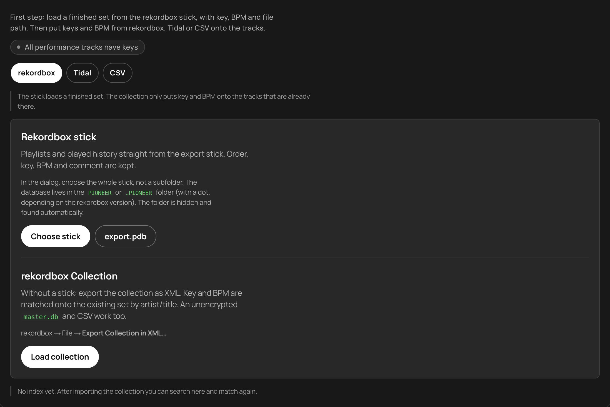
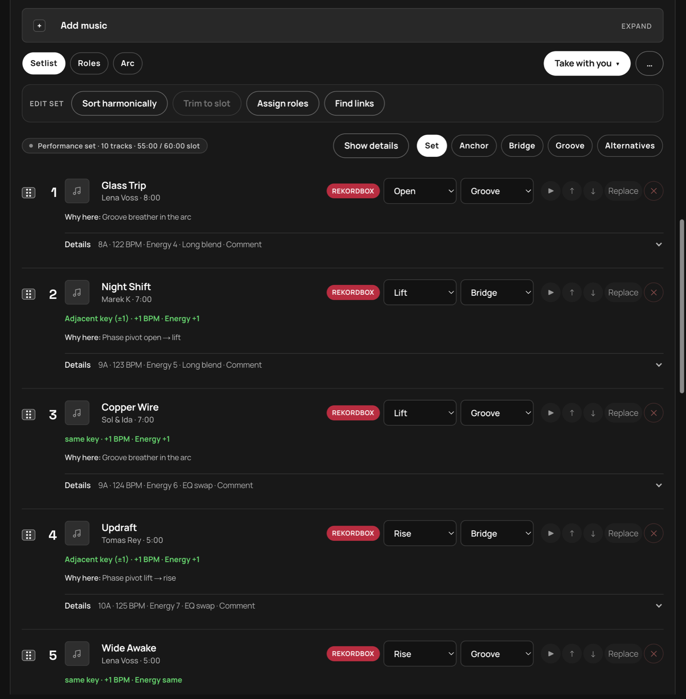
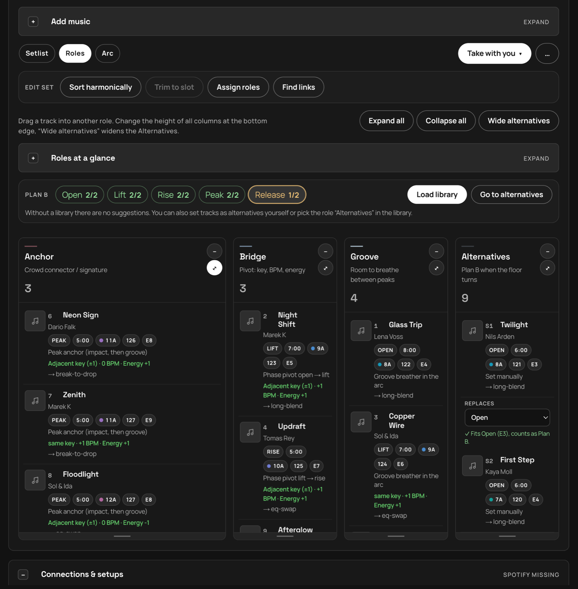
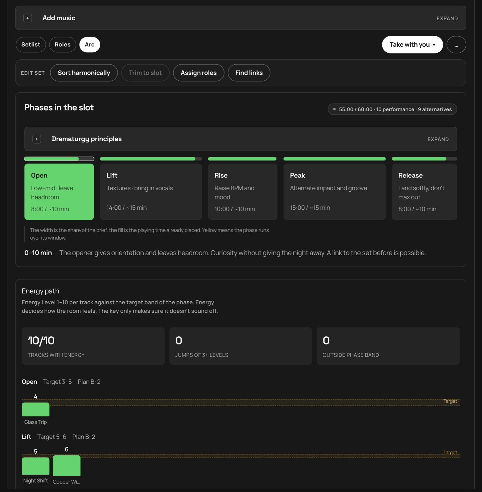
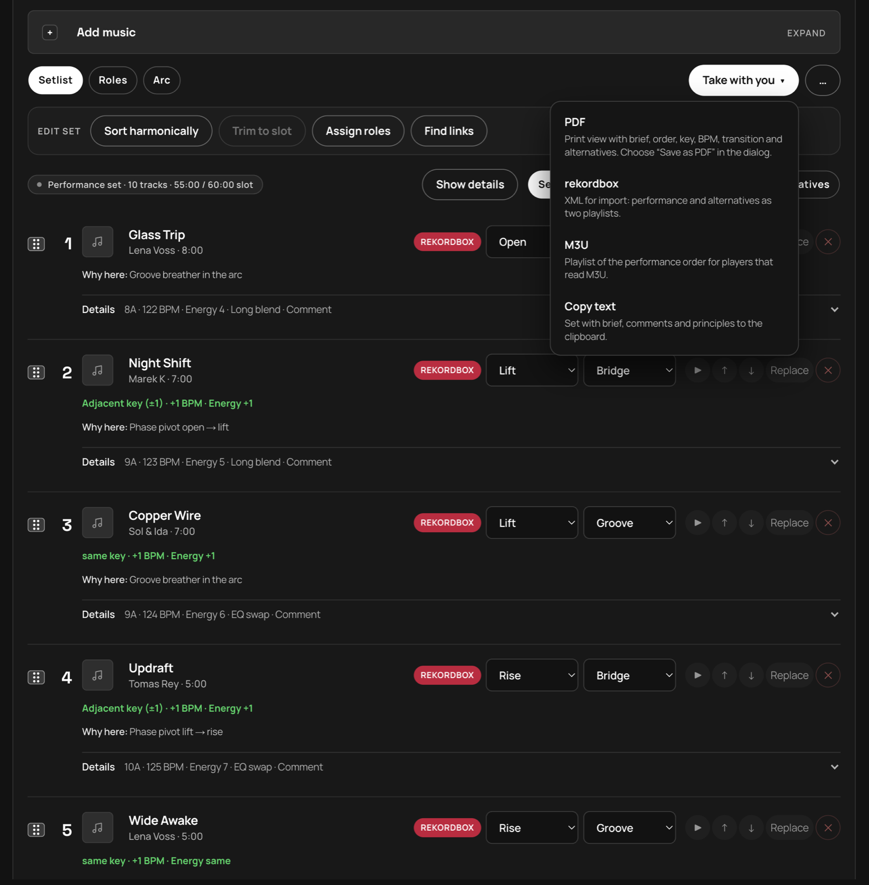

# SETFORM

[Deutsch](README.de.md) · **English**

**Version 2.5.0** · Dramaturgy, not a playlist.

SETFORM prepares DJ sets for rekordbox. You load a playlist or history from the export stick (or a collection XML), lay out the arc by slot and duration, check energy, key and BPM, and take the set with you as rekordbox XML, PDF, M3U or text. The logic follows Mixed In Key: energy first, then key, then BPM. The workflow follows the [DJ.Studio prep workflow](https://dj.studio/blog/dj-set-preparation#crafting-a-dj-set-that-feels-right-advanced-tips): brief → build the set → transitions → export.

> The screenshots show a sample set with made-up titles. The app comes in English and German. Switch with **DE / EN** at the top right; on first launch it follows your browser language.

## How a set works with rekordbox

1. **Brief:** title, vibe, venue, slot type and duration.
2. **Load from rekordbox:** the stick (`export.pdb`) or a collection XML.
3. **Build the set:** check phases and roles, change them by hand or let SETFORM assign them.
4. **Back to rekordbox:** export as XML, with the performance and the alternatives as two playlists.

## 1. Load from rekordbox



**Rekordbox stick.** In the dialog, choose the whole stick, not a subfolder. SETFORM finds the database itself, even in the hidden `PIONEER` or `.PIONEER` folder (depending on the rekordbox version). It reads playlists and the played history. Order, key, BPM and comment are kept, and files from the stick can be previewed directly. If you only have the database, choose `export.pdb`.

**Collection without a stick.** In rekordbox, export via *File → Export Collection in XML…* and load the file. Key and BPM are matched onto the tracks in the set by artist and title. An unencrypted `master.db` and CSV work too. After the import, the library searches across all tracks and matching again fills in missing keys.

**Energy.** The Energy Level (1–10) comes from Mixed In Key. SETFORM reads it from the rekordbox comment (for example `7A - Energy 6`), from the collection XML, from a CSV column `Energy`, or you set it by hand.

## 2. Setlist



Each track shows its source (rekordbox), phase and role. Below are key, BPM and energy, the transition from the previous track (“Adjacent key (±1) · +1 BPM · Energy +1”) and the reasoning (“Why here”). Change the order by dragging or with the arrows; “Replace” swaps a title.

**Edit set**
- **Sort harmonically:** orders within the phases by Camelot key and BPM
- **Trim to slot:** keeps, per phase, the tracks whose energy fits the band; the rest moves to Alternatives
- **Assign roles:** Anchor on the strongest Peak tracks and the closer, Bridge at a phase change, key clash, BPM or energy jump, otherwise Groove
- **Find Spotify links:** looks up a Spotify match for tracks without a link so you can preview them in the set (needs the Spotify credentials, see Setup). Your rekordbox export is unaffected.

## 3. Roles and Plan B



Every track has a phase (Open → Lift → Rise → Peak → Release) and a role:

| Role | Job |
|---|---|
| **Anchor** | Crowd connector, signature track |
| **Bridge** | Pivot between phases: key, BPM, energy |
| **Groove** | Room to breathe between peaks |
| **Alternatives** | Plan B when the floor turns |

Drag titles between the columns. **Plan B** asks for at least two fitting alternatives per phase. An alternative counts for the phase you pick under “Replaces”, as long as its energy fits the phase's band. Otherwise the reason is shown on the card. “Fill gaps” takes suggestions from your rekordbox library that fit the phase's tracks by energy, key and BPM.

## 4. Arc



The arc shows how the phases fill the slot (green fits, yellow runs over the window) and how each track's energy sits against the phase's target band. Jumps of three levels or more are marked. A key clash can't be bought back with matching energy and BPM.

| Phase | Energy target |
|---|---|
| Open | 3–5 |
| Lift | 5–6 |
| Rise | 6–8 |
| Peak | 8–10 |
| Release | 4–6 |

## 5. Back to rekordbox



The **Take with you** menu exports:

- **Write to stick:** adds the set as playlist `SETFORM - <title>` and the alternatives next to it as `SETFORM - <title> Alternatives` in `export.pdb`. Chrome, Edge or the desktop app. The same stick is remembered: after a restart, “Reconnect stick” is enough, and writing does not ask again. Only tracks already on the stick are written; similar titles (remix, original mix) are offered before they go in. If the set is already there, *Update* restores the last backup and writes the current set. Before every write SETFORM copies the original to `SETFORM-Backup/` (the three newest backups stay) and checks the copy. After writing, the database is read and verified; if that fails the old state is put back. XML and M3U are also written to the `SETFORM` folder on the stick. After loading and writing, SETFORM checks whether a player can find the library: if a stale `exportLibrary.db` (OneLibrary) sits next to it, *Prepare for player* moves it to `SETFORM-Backup` so CDJ-3000, XDJ-XZ and older units read `export.pdb`; *Eject stick* flushes the cache with `diskutil`. CDJ-3000X, XDJ-AZ and OPUS-QUAD still need rekordbox — SETFORM cannot write the encrypted OneLibrary. The rekordbox library on the computer is never touched. Try it on a spare or copied stick first, and check that the player shows the playlist.
- **rekordbox XML:** saved as `SETFORM-rekordbox.xml`. In rekordbox set *Preferences → Advanced → Database → rekordbox xml* to this file once; the playlist then appears under *rekordbox xml* in the left tree, right-click → *Import Playlist*. The performance and the alternatives come as two playlists.
- **PDF:** print view with brief, order, key, BPM, transition and alternatives
- **M3U:** playlist in performance order, naming the alternatives playlist on the stick
- **Copy text:** the set with brief, comments and alternatives

Under **Connections & setups** you can save the brief and the set as a setup, load it again, or back it up as JSON.

## More sources

rekordbox is the main route. If keys are missing, Tidal (key and BPM from the catalog via ISRC), CSV or paste fill them in. Titles that aren't in rekordbox yet come into the set by link from Spotify, Tidal, Beatport or SoundCloud. Beatport and SoundCloud need no login: the title comes from the address, and you enter key and BPM by hand or get them through rekordbox.

## Setup

1. Optional, only for Spotify and Tidal features: create a Spotify Developer app and enable **Web API**. rekordbox on its own doesn't need this.
2. Enter the redirect URI **exactly**:
   `http://127.0.0.1:4317/api/auth/callback`
   For Tidal login, additionally: `http://127.0.0.1:4317/api/auth/tidal/callback`
3. Add yourself as a user of the app (Development Mode)
4. Enter the credentials under **Settings** in the app (the app writes them to `.env.local`) or create the file yourself:

```bash
SPOTIFY_CLIENT_ID=…
SPOTIFY_CLIENT_SECRET=…
SPOTIFY_REDIRECT_URI=http://127.0.0.1:4317/api/auth/callback

# Optional — key/BPM from the Tidal catalog (developer.tidal.com)
TIDAL_CLIENT_ID=…
TIDAL_CLIENT_SECRET=…
```

5. Install & run:

```bash
npm install
npm run dev
```

Development: [http://127.0.0.1:4327](http://127.0.0.1:4327). The desktop app stays on port 4317.

## Languages

The interface, the API answers and the exports (PDF, text, rekordbox XML comments) follow the chosen language. The choice is stored in the browser (`setform-lang`). All texts live in [`src/lib/i18n/messages`](src/lib/i18n/messages); the German file comes first, and the English one has to provide every key, otherwise TypeScript fails. A test checks that both languages have the same keys and placeholders.

## Tests

```bash
npm test
```

Runs with the built-in Node test runner. The hooks in [`scripts/test-hooks.mjs`](scripts/test-hooks.mjs) resolve the `@/` alias and imports without an extension. Covered: energy, Camelot rules, trim to slot, replacement ranking, Plan B, export, the stick import and the language files.

## Desktop (Mac, Windows, Linux)

The app lives in [`desktop`](desktop/README.md). `npm start` opens the window. `npm run dist` packages it for the current system. A git tag `v*` builds Mac (Apple Silicon and Intel), Windows and Linux on GitHub and puts the files into the [release](https://github.com/ChrisEdS/setform/releases).

Every installation needs its own developer app for Spotify and Tidal; rekordbox works without. The keys live in `.env.local` or, in the packaged app, in the application data under `.env`. Template: [`.env.example`](.env.example).

### Opening the installer

The current packages aren't signed yet. macOS puts a browser download in quarantine and then says “SETFORM.app is damaged and can't be opened”. The file isn't damaged.

After unpacking, in the terminal, or `desktop/scripts/unquarantine.sh`:

```bash
xattr -dr com.apple.quarantine /Applications/SETFORM.app
```

Adjust the path to wherever the app lives. After that, a double-click opens the app. Alternatively: right-click SETFORM → Open, and click Open once more in the dialog.

Windows shows a SmartScreen notice; “Run anyway” starts the installation. Linux starts the AppImage directly.

Once the Apple and Windows certificates are in as GitHub secrets, the next release will be signed and the quarantine step on the Mac goes away. The steps are in [`desktop/README.md`](desktop/README.md).

## License

MIT, see [LICENSE](LICENSE).
