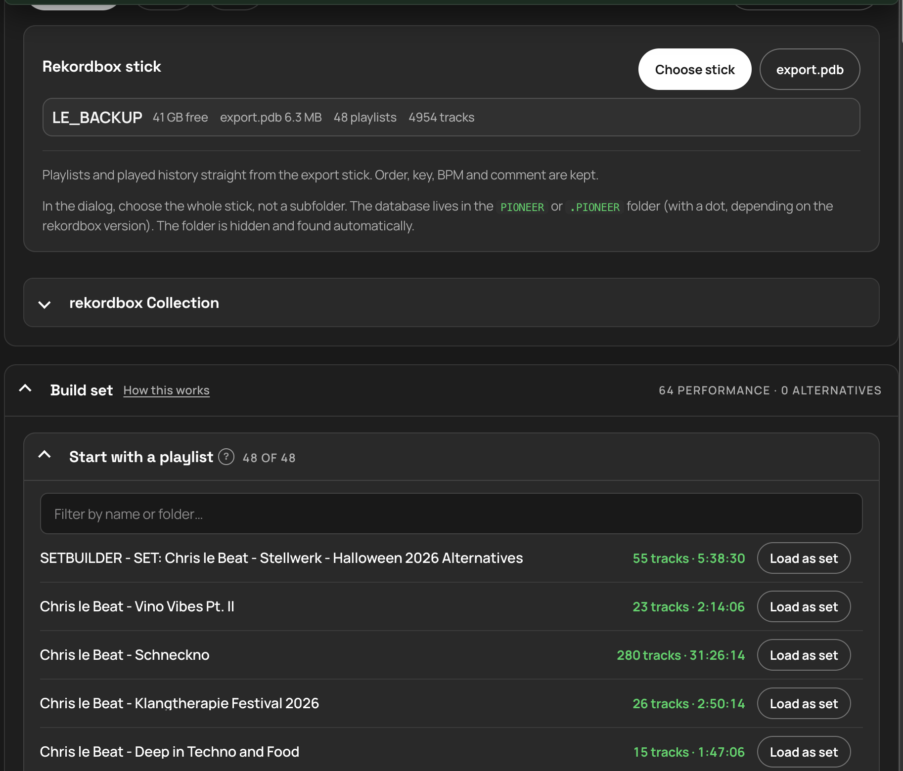
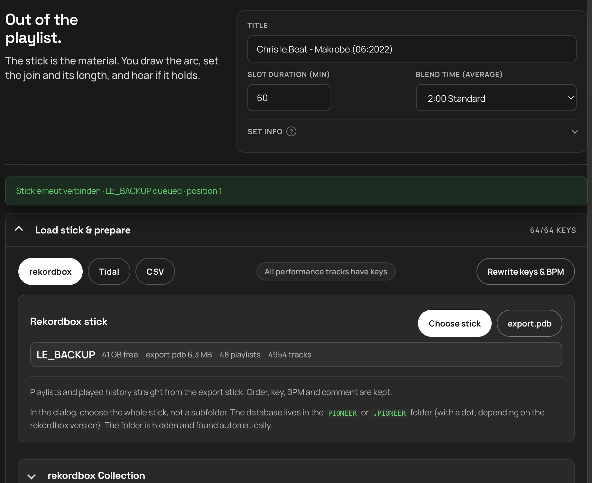
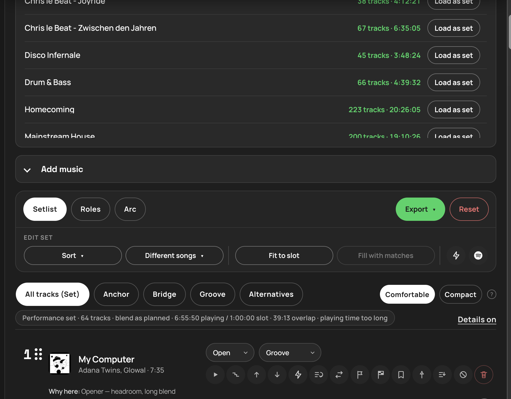
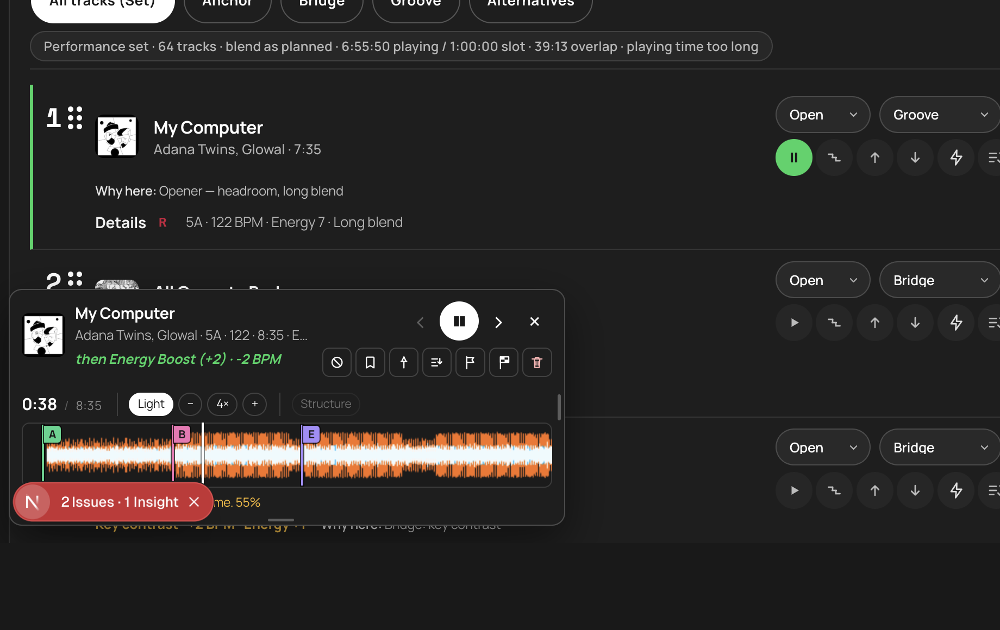
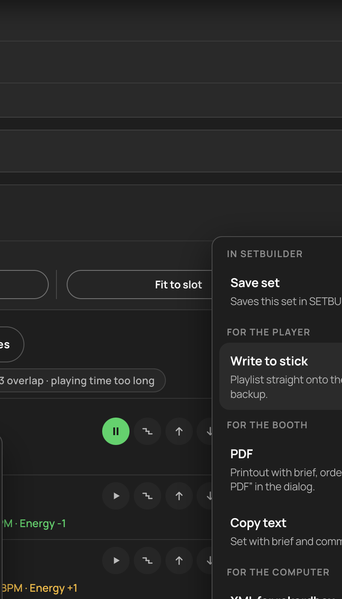

# SETBUILDER-Anleitung

**Deutsch** · [English](GUIDE.md) · [README](../README.de.md)

**Version 5.3.0.** Die Screenshots zeigen die englische Oberfläche in Chrome. **DE** / **EN** oben rechts schaltet die Beschriftungen. Die englische Anleitung folgt denselben Schritten.

Die Desktop-App (Port **4317**) ist der normale Weg. Wer aus dem Repo mit `npm run dev` startet, nutzt Port **4327**.

> **Vor dem Gig:** Stick in SETBUILDER auswerfen, am CDJ/XDJ testen (Playlist sichtbar, Titel spielbar) und ein Backup des Sticks behalten. Für deine Medien bist du selbst verantwortlich.

## Was du machst

1. Stick laden und vorbereiten  
2. Mit einer Playlist starten  
3. Setliste, Rollen und Bogen nutzen  
4. Übergänge im Player hören  
5. Set auf den Stick schreiben  

---

## 1. Stick laden und vorbereiten

1. Schließe deinen rekordbox-USB-Stick an.
2. Öffne oben **Stick laden & vorbereiten**.
3. Erkennt SETBUILDER den Stick, lädt er ohne Ordner-Dialog. Zeigt sich ein Dialog: den Stick wählen (den rekordbox-Export), nicht einen Ordner, der nur Musikdateien enthält.
4. Warte, bis die Bibliothek bereit ist. Du kannst nach Sternen, Farbe, Genre und Kommentar filtern. Playlist-Namen öffnen als Liste unter dem Suchfeld.
5. Achte auf den Statusstreifen am Stick — er sagt, ob der Stick für deinen Player bereit ist.
   - **Gelb** — die Player-Bibliothek auf dem Stick fehlt oder ist älter als die Playlists. Tippe **Für Player vorbereiten**, um sie aus einer Sicherung wiederherzustellen, die SETBUILDER behält. Nichts auf dem Stick wird gelöscht.
   - **Grün** — die Stick-Datenbank ist lesbar. Neuere Player zeigen manchmal noch eine ältere Fassung; Streifen und **Details** erklären das.
6. Für einen anderen Stick: **Anderer Stick**.

Unter **Set bauen** listet **Mit einer Playlist starten** die Playlists auf dem Stick. Titel vom Stick lassen sich im Player abspielen, sobald der Stick geladen ist.

---

## 2. Mit einer Playlist starten

1. Unter **Set bauen** öffnest du **Mit einer Playlist starten**.
2. Wählst du eine Playlist, tippst du auf **Als Set laden**.
3. Hat das Set schon Titel: **Ersetzen** (einmal überschreiben, mit **Rückgängig**), **Zusammenführen** (Set behalten, nur fehlende Titel anhängen) oder **Abbrechen**.
4. Die Playlist-Reihenfolge wird deine Setliste. Key und BPM bleiben wie auf dem Stick.

Oben setzt der **Brief**:

- **Titel** — Name des Sets.
- **Slot-Dauer (Min)** — Zeitfenster für deinen Gig (der **Slot**).
- **Blend-Zeit (Durchschnitt)** — wie lange jeder Anschluss im Schnitt in den nächsten Titel überlappt (die **Blend**). SETBUILDER nutzt das, wenn in der Zeile noch keine Übergangs-Länge steht.

**Set-Info** (Vibe, Venue, Slot, Audience, Gear, Notes) ist nur deine Gig-Notiz. Sie ändert die Uhr nicht.

Die Statuszeile unter dem Set zeigt **Spielzeit** und Slot. **Spielzeit** ist die Summe der Dateilängen minus die geplante Überlappung pro Zeile. Ein 60-Minuten-Slot kann länger als 60 Minuten Spielzeit haben und trotzdem passen; ist die Spielzeit für den Slot zu lang, sagt die Statuszeile das.

**Alternativen** (Plan-B-Titel) liegen neben der Performance. Sie zählen nicht zur Spielzeit, bis du sie in die Performance schiebst.

---

## 3. Setliste, Rollen und Bogen

1. Wechsle oben an der Setliste **Setliste**, **Rollen** und **Bogen**. Dieselben Titel, drei Ansichten:
   - **Setliste** — Wiedergabereihenfolge. Sortieren am Griff oder mit Pfeilen. Kommentare. **Details** pro Zeile für Key, BPM, Energie und Übergangs-Notizen.
   - **Rollen** — jeder Performance-Titel hat eine **Rolle** (seine Aufgabe): **Anchor** (Signature-Moment), **Bridge** (sorgfältiger Anschluss, wenn Key, BPM oder Energie springt), **Groove** (ruhiger Takt zwischen Peaks), **Alternativen** (Reserve; nur reinziehen, wenn du sie brauchst).
   - **Bogen** — wie die Energie über den Slot läuft. Jeder Titel sitzt in einer **Phase**: **Open**, **Lift**, **Rise**, **Peak** oder **Release**. So siehst du, ob Aufbau und Höhepunkt zur Slot-Dauer passen.

2. In jeder Zeile setzt du den **Übergang** (Cut, Blend, EQ swap, Echo-out, …) und die **Länge** (Überlappung). Die Überlappung zieht von der Spielzeit in dieser Zeile ab. Länge leer lassen: SETBUILDER schlägt eine Zeit aus der Blend vor.

3. **Behalten** lässt den Titel im Set, Sortieren darf ihn verschieben. **Genau hier** pinnt den Slot. **Opener** und **Closer** halten den ersten und letzten Performance-Titel.

4. Unter **Beim Hinzufügen** wählst du, wo der nächste Titel landet: hinter einem Titel deiner Wahl, am Ende oder **Automatisch** (hinter dem besten Follow in Key, BPM und Energie — zuerst in seiner Phase, dann überall).

5. **Auf Slot setzen** kürzt, wenn die Spielzeit über dem Slot liegt (Titel wandern zu Alternativen), oder füllt aus Alternativen und dem Playlist-Pool, wenn es zu kurz ist. Opener, Closer und Pins bleiben.

6. **So ist es gedacht** in der App passt zu dieser Anleitung.

---

## 4. Übergänge im Player hören

1. Tippe **Play** in einer Zeile. Der Player öffnet sich über der Setliste und hält die spielende Zeile sichtbar.
2. Nutze **Vorhören** (**Vorher** / **Jetzt** / **Danach**), um zu hören, wie dieser Titel in den nächsten übergeht — dieselben Längen wie im Set.
3. Passe Übergangs-Marke und Länge beim Hören an. Diese Notizen bleiben im Set, nicht in der Audiodatei auf dem Stick.
4. Player am rechten oder unteren Rand größer ziehen. **+** zoomt die Wellenform. **Q** rastet neue Hot Cues **A–H** auf das rekordbox-Beatgrid ein, wenn ein Grid da ist. **−5**, **+5** und **1** schieben das Grid. Neue Cues können auf den Stick geschrieben werden, sobald die Analyse dazu passt.
5. Ist **Light** aus, sitzt ein Tempo-Fader rechts neben der Wellenform. Oben ist schneller. **±10** schaltet auf **±25**; die Stellung bleibt, der Prozentwert skaliert. **MT** hält die Tonart. **Tempo** neben **Q** blendet den Fader aus; das Tempo bleibt, und der Schalter zeigt den Prozentwert, wenn er nicht null ist. Doppelklick auf den Prozentwert setzt ihn auf 0. **Light** hat keinen Fader.

---

## 5. Auf den Stick schreiben

1. Öffne **Exportieren**.
2. **Für den Player** — **Auf Stick schreiben**. SETBUILDER legt das Set als neue Playlist auf dem Stick ab (Performance-Titel plus Alternativen). Nur Titel, die schon auf dem Stick liegen. Vor dem Schreiben entsteht eine Sicherung; bei Problemen kannst du zurückrollen.
3. **Im Setbuilder** — **Set speichern** behält deine Arbeit in der App, ohne den Stick anzufassen.
4. **Für die Kabine** — **PDF** oder **Text kopieren** als Zettel (Brief, Reihenfolge, Keys, BPM, Energie wenn bekannt).
5. **Für den Rechner** — **XML für rekordbox** oder **M3U** zum Import woanders (nicht dasselbe wie Auf den Stick schreiben).

6. Wenn das Schreiben fertig ist, wirf den Stick in SETBUILDER aus, bevor du ihn abziehst.

---

## Vor dem Gig

Lesen, Import und Schreiben am Stick laufen nacheinander; der Rest der App bleibt bedienbar. An der Hardware, die du wirklich spielst: Playlist sichtbar, Titel laden. Ordnerrechte und voller Stick kann SETBUILDER nicht für dich prüfen.

---

## Weiterführend

- [README](../README.de.md) — installieren, Desktop-Download, Lizenz  
- [Desktop-Paketierung](../desktop/README.md) — Build und Signierung für Entwickler  
