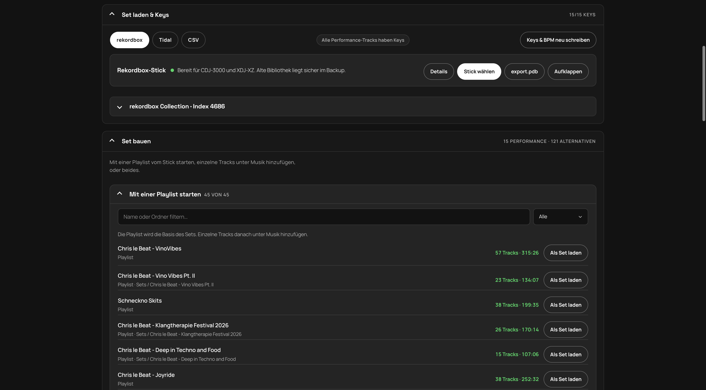
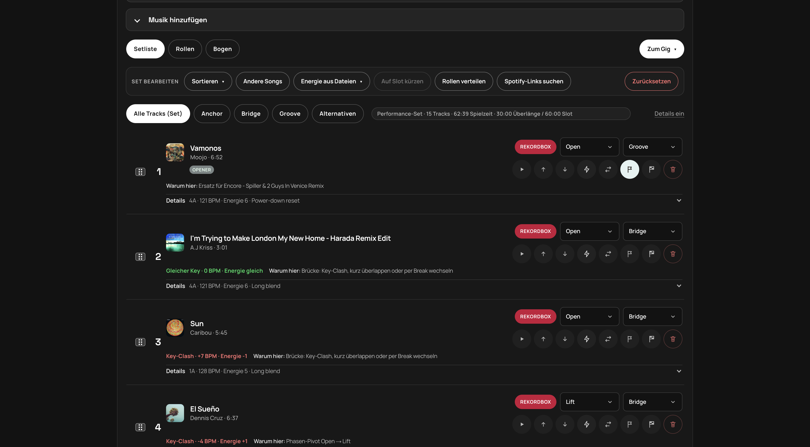
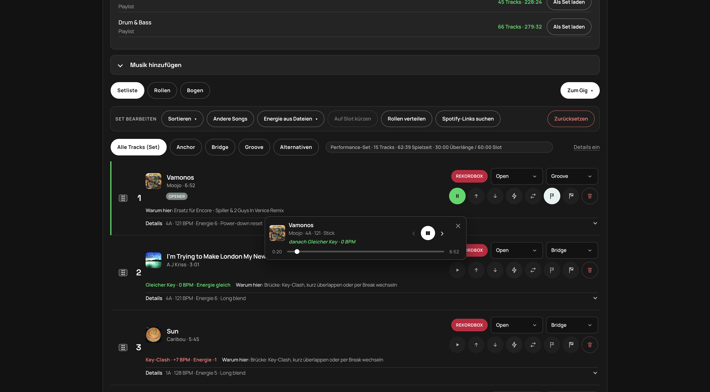
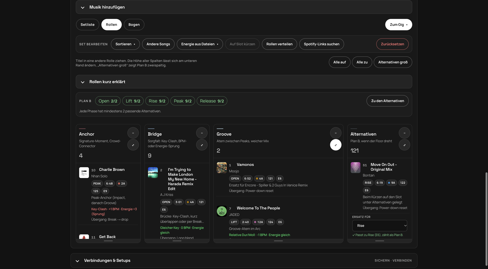
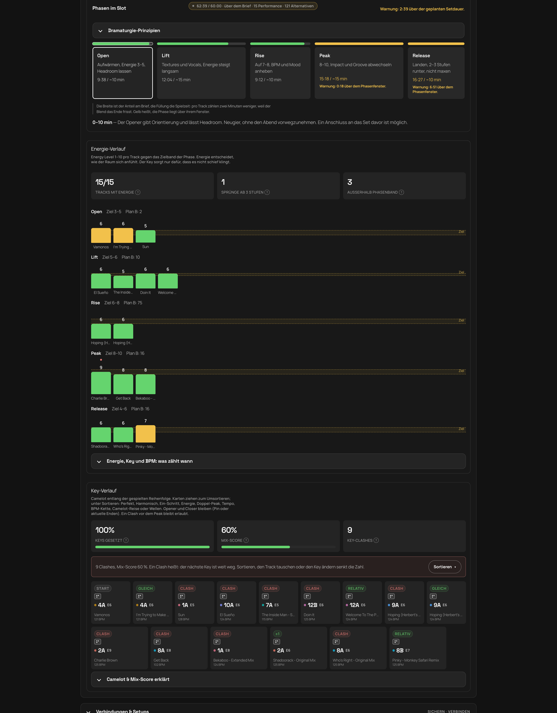
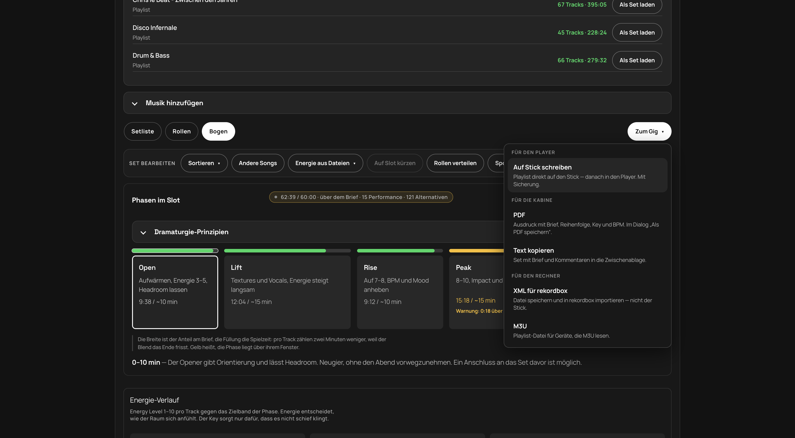

# SETBUILDER-Anleitung

**Deutsch** · [English](GUIDE.md) · [README](../README.de.md)

So bereitest du ein Set mit rekordbox vor: Bibliothek verbinden und verstehen → bauen → exportieren. Die Screenshots zeigen ein in der App geöffnetes Set.

Die ausgelieferte App ist die Desktop-App (Port **4317**). Die Browser-Entwicklung nutzt Port **4327**. Dieses Dokument beschreibt **4.0.0**. Stick-Schreiben, Player und Streaming-Konten sind weiter ungeprüft.

> **Vor dem Gig:** Stick immer am echten Player testen (Playlist sichtbar, Tracks spielbar). Backup behalten — SETBUILDER schreibt in `export.pdb` und legt Kopien unter `SETBUILDER-Backup/` ab, für deine Medien bist du selbst verantwortlich. Keine Garantie. Works on my machine. :)

## So läuft ein Set mit rekordbox

1. **Brief:** Titel, Vibe, Venue, Slot-Art und Dauer.
2. **Set laden & Keys:** Stick verbinden und das aktuelle Set/die Bibliothek optional aus Collection-XML, CSV oder unverschlüsselter Datenbank anreichern.
3. **Set bauen:** mit Stick-Playlist starten, Musik hinzufügen oder beides kombinieren; dann Phasen, Rollen und Reihenfolge prüfen.
4. **Mitnehmen:** Stick-Playlist aktualisieren, Kabinen-PDF/Text erstellen oder XML/M3U exportieren.

## 1. Set laden & Keys

**Rekordbox-Stick.** Am besten **Stick wählen** (Chrome / Edge / Desktop) für die Volume-Wurzel, oder `PIONEER` / `PIONEER/rekordbox`. Wenn der Ordner-Dialog fehlschlägt oder hängt: **export.pdb** (`PIONEER/rekordbox/export.pdb` oder `.PIONEER/…`) — der zuverlässigste Weg. Nicht den ganzen USB mit allen Musikdateien wählen, das kann ewig dauern. SETBUILDER findet die Datenbank selbst, auch im versteckten Ordner `PIONEER` oder `.PIONEER`. Gelesen werden Playlists und die gespielte History. Reihenfolge, Key und BPM bleiben erhalten; der Energy Level wird aus dem rekordbox-Kommentar gelesen, wenn Mixed In Key ihn dort geschrieben hat. Dateien vom Stick lassen sich direkt vorhören. Während Dialog, Dateiliste und Datenbank-Lesen steht ein Status.

**Cover.** Das Bild kommt aus `PIONEER/Artwork` auf dem Stick (zuerst die größere `_m`-Datei, dann das kleinere JPEG). Fehlt die Artwork-Datei, liest SETBUILDER das Front-Cover aus dem ID3-APIC-Frame der MP3. Beide Wege brauchen den Stick-Ordner in der aktuellen Sitzung.

**Player-Check.** Nach dem Wählen zeigt ein kurzer Strip ein Urteil und eine Primäraktion (Für Player vorbereiten, Auswerfen oder rekordbox öffnen). Details liegen hinter einem Toggle: grüne / gelbe / rote Punkte markieren echten Status (Ordner, Datenbank, Player-Bibliothek); Zeilen ohne Punkt sind nur Info (z. B. noch keine SETBUILDER-Playlists). Grün heißt: Device-Library-Player können den Stick nutzen; Amber heißt: es fehlt noch ein Schritt — oft *Für Player vorbereiten*, damit die alte OneLibrary deine Playlists nicht verdeckt, danach *Auswerfen*.

**Collection-Anreicherung.** In rekordbox unter *File → Export Collection in XML…* exportieren und laden. Unverschlüsselte `master.db` und CSV gehen ebenfalls. Diese Quellen indexieren die Bibliothek und matchen Metadaten wie Key/BPM auf Tracks, die schon im Set stehen; allein starten, ersetzen oder bilden sie **kein** Set. Die Playlist-Auswahl liegt unter **Set bauen**. Nach dem Import sucht die **Bibliothek** nach Artist, Titel oder Key. **Passt zu** rankt Tracks hinter einem gewählten Set-Track; **5 andere** blättert weitere Treffer.

**Energie.** Der Energy Level (1–10) kommt aus Mixed In Key. SETBUILDER liest ihn aus dem rekordbox-Kommentar (zum Beispiel `7A - Energy 6`, `Energie 6`), aus Grouping / Label / Remixer in der Collection-XML oder CSV (`Energy` / `Energie`), aus einer nackten `6` oder `E8` in diesen Feldern, oder von Hand in der Setliste. Der USB-`export.pdb` hat Kommentare, aber kein Grouping — in rekordbox Tags neu laden und die Collection-XML laden, wenn die Energie leer bleibt.

**Set-Notiz.** In den Track-Details ist die **Set-Notiz** nur für die Kabine (Cue, Floor). Sie erscheint in PDF und kopiertem Text, niemals in rekordbox Comments oder ID3-Tags.

**Energie aus Dateien.** Wenn Stick-Dateien da sind, trennt das Menü **Aus Tags lesen** (ohne Audio-Decoding), **Fehlende messen**, **Alle neu berechnen** (messen ohne Schreiben) und **In MP3 schreiben**. Ohne verbundenen Stick zeigt das Menü genau diese Voraussetzung und **Stick wählen** — das öffnet den vorhandenen Stick-Dialog unter Set laden & Keys. Ist der Stick da, aber kein Track hat einen Dateipfad, steht diese Voraussetzung statt vier leerer Aktionen. MP3-Schreiben ergänzt `TXXX EnergyLevel` plus `Energy N` im Dateikommentar; jede ersetzte Datei wird erneut geöffnet und bytegenau geprüft, bei Fehler wird das Original wiederhergestellt. Key, BPM, Set-Notiz und Audiodaten bleiben unverändert. Danach Tags in rekordbox neu laden; `export.pdb` und die `master.db` auf dem Rechner werden durch diese Aktion nicht geändert. Die Analyse nutzt [essentia.js](https://github.com/MTG/essentia.js) (AGPL-3.0). Die Kalibrierung mit echten Medien ist nicht geprüft.

## 2. Set bauen

Unter **Set bauen** wählst du **Mit einer Playlist starten** vom verbundenen Stick, nutzt **Musik hinzufügen** oder kombinierst beides. Beim Laden einer Playlist über ein nicht leeres Set fragt SETBUILDER:
- **Ersetzen** überschreibt die aktuelle Setliste und bietet einmal **Rückgängig** zur vorherigen Setliste.
- **Zusammenführen** behält die aktuelle Setliste und hängt nur Tracks an, die noch nicht enthalten sind.
- **Abbrechen** ändert nichts.

Collection-XML/CSV/DB löst diese Auswahl nie aus, weil es nur Metadaten und Bibliothek anreichert.

Jeder Track zeigt die Quelle (rekordbox), Phase und Rolle. Phase und Rolle stehen in einer Zeile. Darunter liegen Icon-Buttons: Play, hoch, runter, Energie (Blitz), Ersatz, Opener (Fahne), Closer (karierte Flagge) und Entfernen. Energie nutzt denselben Hover-Tipp wie die anderen Icons. Darunter stehen Key, BPM und Energie, der Übergang zum Vorgänger („Nachbar-Key (±1) · +1 BPM · Energie +1“) und die Begründung („Warum hier“). Die Reihenfolge änderst du per Ziehen oder mit den Pfeilen.

**Ersatz** öffnet eine Schublade über der Setliste, die Tracks darunter rutschen nicht. Die Kopfzeile behält den Tracknamen („Für „Name““). Der Fokus geht in die Schublade; Schließen oder Escape bringt ihn zum Ersatz-Button zurück. Play in dieser Liste ist derselbe runde Play-Button wie in der Setlisten-Zeile. Einsetzen tauscht den Titel.

Der Vorhör-Player ist eine kompakte schwebende Karte, etwa 512px breit, keine Leiste über die ganze Fensterbreite. Am Titelstreifen ziehen; die Karte bleibt im Fenster. Schließen sitzt oben rechts. Zurück, Play/Pause und Weiter bleiben zusammen. Die Karte liegt über der Ersatz-Schublade, der Player bleibt erreichbar, solange Ersatz offen ist.

**Opener & Closer.** Einen Performance-Track als **Opener** pinnen (bleibt vorne, Phase Open) oder als **Closer** (bleibt hinten, Phase Release). Beim Extrahieren schlägt SETBUILDER warme Open-/Release-Pins vor; du kannst sie jederzeit ändern oder lösen. Sortieren hält gepinnte Enden — und ohne Pin bleiben die aktuellen ersten und letzten Performance-Tracks sowieso an den Enden.

**Set bearbeiten**
- **Sortieren:** die meisten Techniken nur innerhalb einer Phase (Alternativen bleiben am Ende; Opener/Closer bleiben insgesamt vorne/hinten). **Perfekt · Max Score** ist anders: es ordnet die ganze Performance über Phasengrenzen neu und legt Open→Release danach nach Timeline neu. Dasselbe Menü in der Setliste und im Key-Verlauf. Ändert sich nichts, sagt SETBUILDER das — oft fehlen Key/Energie/BPM, oder eine Phase hat nur ein bis zwei Tracks.

  | Technik | Was sie macht |
  |---|---|
  | **Perfekt · Max Score** | Ganzes Set als Camelot-TSP (exakt Held-Karp ≤18 Tracks, sonst NN+2-opt/Or-opt). Zuerst Clashes minimieren, dann Mix-Score maximieren. Opener/Closer bleiben; Phasen werden danach neu gelegt. 100 % nur wenn alle Keys auf dem Wheel verbunden sind — getrennte Cluster lassen weiterhin einen Bridge-Clash |
  | **Harmonisch** | Pro Phase: verwandte Camelot-Keys, weiche Energie, kleine BPM-Schritte |
  | **Ein-Schritt** | Pro Phase · Mixed In Key: Energie bevorzugt ±1 mit der Phase |
  | **Energie-Welle** | Pro Phase: steigt Open→Peak, fällt im Release; Key ist der Tiebreaker |
  | **Doppel-Peak** | Pro Phase: im Peak aufbauen, kurz −2, wieder hoch; Open/Lift/Rise nur steigen |
  | **Tempo aufbauen** | Pro Phase: BPM-Rampe mit der Phase |
  | **BPM-Kette** | Pro Phase: im ±2–4-Pocket bleiben |
  | **Camelot-Reise** | Pro Phase: im Uhrzeigersinn ums Wheel (stapelt denselben Key nicht) |
  | **Wellen** | Pro Phase: im Peak Groove ↔ Impact (Anchor); sonst Low/High-Energie |

- **Andere Songs:** zwischen Sortieren und Energie. Würfelt eine neue Performance für denselben Brief aus der Stick-Bibliothek (alle Playlists auf dem Export-Stick) oder, nach einem Extract, aus diesem Playlist-Pool. Confirm vorher; Opener/Closer-Pins bleiben, Notizen gehen verloren. Ohne größere Auswahl als das Set bleibt der Button aus.
- **Energie aus Dateien:** mit Stick-Dateien Tags lesen, fehlende messen, alle neu berechnen oder gesetzte Level ausdrücklich in MP3 schreiben. Messen schreibt keine Dateien. Ohne Stick zeigt das Menü diese Voraussetzung und **Stick wählen**. Ohne Dateipfade steht die Voraussetzung statt vier leerer Aktionen.
- **Auf Slot kürzen:** behält pro Phase die Tracks, deren Energie ins Band passt; der Rest wandert unter Alternativen
- **Rollen verteilen:** Anchor auf den stärksten Peak-Tracks und den Schluss, Bridge bei Phasenwechsel, Key-Clash, BPM- oder Energie-Sprung, sonst Groove
- **Spotify-Links suchen:** sucht zu Tracks ohne Link einen Spotify-Treffer, damit du sie im Set vorhören kannst (braucht die Spotify-Zugangsdaten, siehe [Setup im README](../README.de.md#setup)). Der rekordbox-Export bleibt davon unberührt.

## 3. Rollen und Plan B

Jeder Track hat eine Phase (Open → Lift → Rise → Peak → Release) und eine Rolle:

| Rolle | Aufgabe |
|---|---|
| **Anchor** | Crowd-Connector, Signature-Track |
| **Bridge** | Pivot zwischen Phasen: Key, BPM, Energie |
| **Groove** | Atem zwischen den Peaks |
| **Alternativen** | Plan B, wenn der Floor dreht |

Titel lassen sich zwischen den Spalten ziehen. **Plan B** verlangt pro Phase mindestens zwei passende Alternativen. Eine Alternative zählt für die Phase, die du bei „Ersatz für“ wählst, solange ihre Energie ins Band der Phase passt. Sonst steht der Grund auf der Karte. „Lücken füllen“ nimmt Vorschläge aus deiner rekordbox-Bibliothek, die nach Energie, Key und BPM zu den Tracks der Phase passen.

## 4. Bogen

Der Bogen zeigt, wie die Phasen den Slot füllen (aktive Phase hervorgehoben; gelb heißt über dem Fenster) und wie die Energie jedes Tracks zum Zielband der Phase steht. Sprünge ab drei Stufen werden markiert. Die Zeit folgt einer festen Schätzung: Jeder Performance-Track zählt mit Dateidauer minus zwei Minuten Überblendung, mindestens jedoch 30 Sekunden. Cue-Punkte, Übergangslänge und Live-Entscheidungen kennt das Modell nicht; Slot-Fit ist deshalb nur Orientierung.

**Key-Verlauf** zeigt Camelot entlang der gespielten Reihenfolge. Jede Karte hat ein kurzes Relationen-Badge (Gleich, ±1, Clash, …), den Key, Energie wenn bekannt und BPM. Karten ziehen zum Umsortieren; **Sortieren** für die Techniken oben. Drei Kacheln mit **?** erklären die Zahlen:
- **Keys gesetzt** — Anteil der Performance-Tracks mit Camelot-Key
- **Mix-Score** — Mittel aller Übergänge (Key und Energie zu gleichen Teilen, kleine BPM-Korrektur). Über ~75 % ist weich, unter ~50 % knallt es oft
- **Clashes** — Übergänge, deren Keys auf dem Camelot-Wheel weit auseinanderliegen

Sortieren (besonders **Perfekt · Max Score**), Ziehen oder Key/Energie in der Setliste ändern die Zahlen. Ein Key-Clash lässt sich nicht allein durch gleiche Energie und BPM ausgleichen — wenn zwei Camelot-Cluster sich nie berühren (z. B. 1A/12A vs. 8A/9A), lässt Perfekt trotzdem die wenigsten Bridge-Clashes übrig.

| Phase | Energie-Ziel |
|---|---|
| Open | 3–5 |
| Lift | 5–6 |
| Rise | 6–8 |
| Peak | 8–10 |
| Release | 4–6 |

## 5. Mitnehmen

Das Menü **Mitnehmen** ist nach Ziel gruppiert:

### Für den Player

- **Auf Stick schreiben** (Hauptweg): Playlist `SETBUILDER - <Titel>` plus Alternativen als `SETBUILDER - <Titel> Alternativen` in die **aktuelle** `export.pdb`. Das Erstellen oder Aktualisieren dieser benannten Playlists ist gezielt und transaktional: fremde Datenbankänderungen bleiben erhalten, vorher entsteht ein Backup, danach wird zurückgelesen, bei Fehler erfolgt Rollback. Nur Titel, die schon auf dem Stick liegen, werden geschrieben; mehrdeutige ähnliche Treffer brauchen eine ausdrückliche Auswahl. XML und M3U landen zusätzlich in `SETBUILDER/`. Der Health-Strip kann ältere Device-Library-Player vorbereiten und bietet Auswerfen. CDJ-3000X, XDJ-AZ und OPUS-QUAD brauchen weiter rekordbox für OneLibrary; das Verhalten der CDJ/XDJ-Familien muss an echter Hardware geprüft werden. Die `master.db` auf dem Rechner bleibt unangetastet.

### Für die Kabine

- **PDF:** Druckansicht mit Brief, Reihenfolge, Key, BPM und Kabinen-Set-Notizen (im Dialog „Als PDF speichern“)
- **Text kopieren:** Set mit Brief und Kabinen-Set-Notizen in die Zwischenablage

### Für den Rechner

- **XML für rekordbox:** Datei `SETBUILDER-rekordbox.xml` zum *Import* in rekordbox — schreibt nicht den Stick. In rekordbox einmal *Einstellungen → Erweitert → Datenbank → rekordbox xml* auf diese Datei setzen; dann links unter *rekordbox xml* → Rechtsklick → *Playlist importieren*. Performance und Alternativen als zwei Playlists.
- **M3U:** Playlist-Datei für Geräte, die M3U lesen

Der Brief und das Set lassen sich unter **Verbindungen & Setups** als Setup speichern, wieder laden oder als JSON sichern. Der Speichern-Name folgt dem Set-Titel aus dem Brief.

## Schwere Arbeit und Prüfgrenzen

Stick-Reconnect/-Import, Collection-Import, Energie-Taglesen, Messungen und Schreiben sind benannte schwere Jobs. Sie laufen in einer einzigen Queue: Der Status zeigt laufenden Job oder Warteposition, schwere Operationen laufen niemals parallel. Die übrige Oberfläche bleibt bedienbar.

Chrome und die installierte Desktop-App haben einen echten Stick nur lesend gezeigt (Collection, Playlists, History, ein geladenes Set, Cover). Stick-Schreiben, CDJ/XDJ-Wiedergabe, Spotify-/Tidal-Konten, Auswerfen und Energie-Kalibrierung auf echten Medien sind nicht geprüft. SETBUILDER kann auch Browser-Ordnerrechte, USB-Abbruch/vollen Datenträger, rekordbox-Import/Tag-Reload, Drucken/Zwischenablage oder Codec-Abdeckung nicht beweisen. Prüfe die Pfade, die du vor dem Gig brauchst.

## Weitere Quellen

rekordbox ist der Hauptweg. Fehlen Keys, ergänzen Tidal (Key und BPM aus dem Catalog per ISRC), CSV oder Paste sie. Titel, die noch nicht in rekordbox liegen, kommen per Link von Spotify, Tidal, Beatport oder SoundCloud ins Set. Bei Beatport und SoundCloud ist kein Login nötig, der Titel kommt aus der Adresse, Key und BPM trägst du von Hand ein oder holst sie über rekordbox.

## Weiterführend

- [README](../README.de.md) — Setup, Desktop-Download, Sprachen, Tests, Lizenz
- [Desktop-Paketierung](../desktop/README.md) — Build, Signierung, Quarantäne
