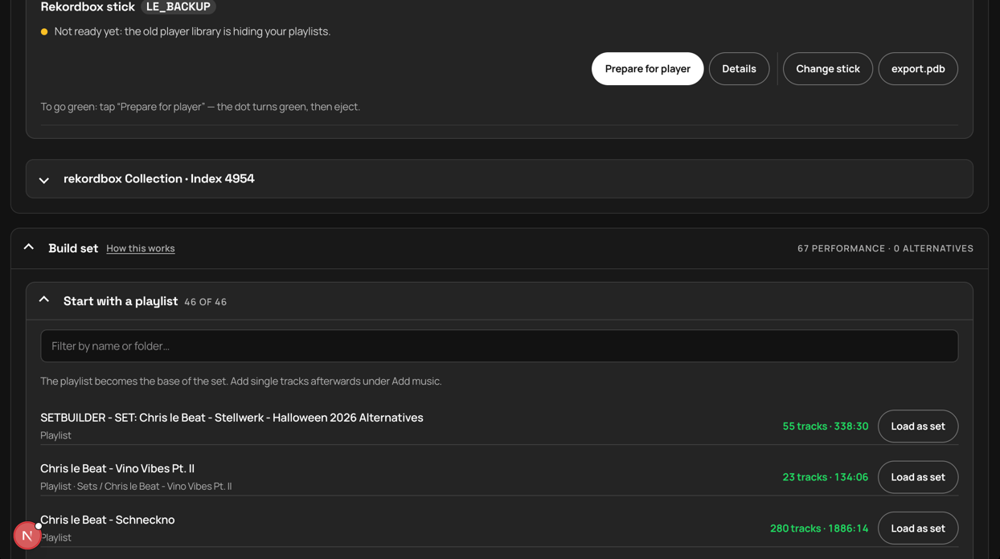
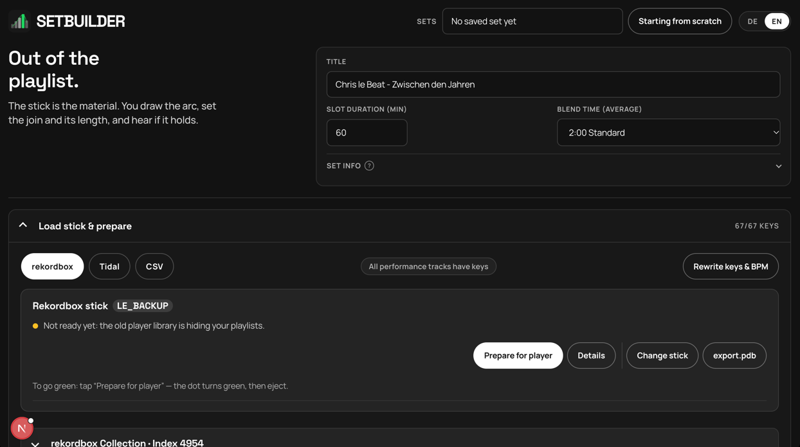
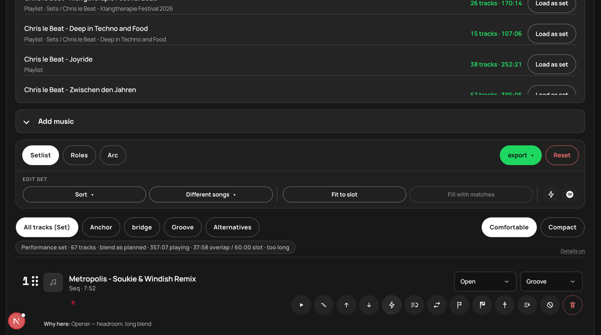
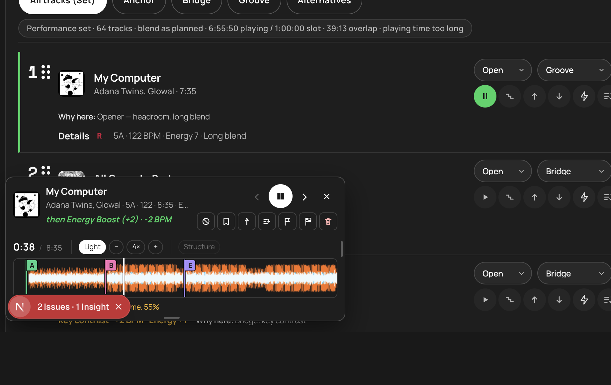
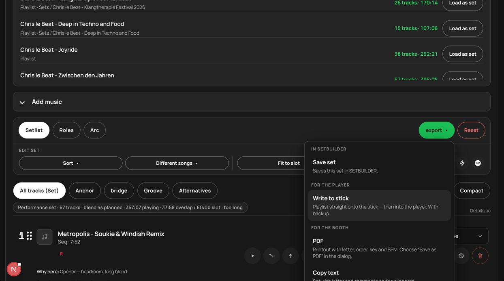

# SETBUILDER manual

[Deutsch](GUIDE.de.md) · **English** · [README](../README.md)

**Version 5.3.0.** Screenshots show the English interface in Chrome. **DE** / **EN** at the top right switches the labels. The German manual follows the same steps.

The desktop app (port **4317**) is what you normally install. If you run from the repo with `npm run dev`, use port **4327**.

> **Before the gig:** Eject the stick in SETBUILDER, test it on your CDJ/XDJ (playlist visible, titles playable), and keep a backup of the stick. You are responsible for your media.

## What you will do

1. Load and prepare the stick  
2. Start with a playlist  
3. Use the set list, roles, and arc  
4. Hear transitions in the player  
5. Write the set back to the stick  

---

## 1. Load and prepare the stick

1. Plug in your rekordbox USB stick.
2. Open **Load stick & prepare** at the top of the screen.
3. If the stick is recognized, SETBUILDER loads it without a folder dialog. If a dialog appears, choose the stick (the rekordbox export), not a folder that only holds music files.
4. Wait until the library is ready. You can filter by stars, color, genre, and comment. Playlist names open as a list under the search field.
5. Watch the status strip on the stick panel — it tells you whether the stick is ready for your player.
   - **Amber** — the player library on the stick is missing or older than the playlists. Tap **Prepare for player** to restore it from a backup SETBUILDER keeps. Nothing on the stick is deleted.
   - **Green** — the stick database is readable. Newer decks sometimes still show an older copy; the strip and **Details** explain what to do.
6. To switch sticks, use **Change stick**.

Under **Build set**, **Start with a playlist** lists the playlists on the stick. Titles from the stick can play in the player once the stick is loaded.

---

## 2. Start with a playlist

1. In **Build set**, open **Start with a playlist**.
2. Pick a playlist and tap **Load as set**.
3. If the set already has titles, choose **Replace** (overwrite once, with **Undo**), **Merge** (keep the set and add missing titles only), or **Cancel**.
4. The playlist order becomes your set list. Keys and BPM stay as on the stick.

At the top, the **brief** sets:

- **Title** — name of the set.
- **Slot duration (min)** — the time window for your gig (the **slot**).
- **Blend time (average)** — how long each join overlaps into the next title on average (the **blend**). SETBUILDER uses this when a row has no transition length yet.

**Set info** (vibe, venue, slot, audience, gear, notes) is only your gig note. It does not change the clock.

The status line under the set shows **playing time** and the slot. **Playing time** is the sum of file lengths minus the planned overlap on each row. A 60-minute slot can be longer than 60 minutes of playing time and still fit; if playing time is too long for the slot, the status line says so.

**Alternatives** (Plan B titles) sit beside the performance. They do not count toward playing time until you move them into the performance.

---

## 3. Set list, roles, and arc

1. Switch **Setlist**, **Roles**, and **Arc** at the top of the set. Same titles, three views:
   - **Setlist** — playback order. Sort with the grip or arrows. Add comments. Open **Details** per row for key, BPM, energy, and transition notes.
   - **Roles** — each performance title has a **role** (its job): **Anchor** (signature moment), **Bridge** (careful join when key, BPM, or energy jumps), **Groove** (steady breath between peaks), or **Alternatives** (reserve; drag in only when you need them).
   - **Arc** — how energy runs across the slot. Each title sits in a **phase**: **Open**, **Lift**, **Rise**, **Peak**, or **Release**. The arc helps you see whether the build and peak match the slot duration.

2. In each row, set the **transition** (cut, blend, EQ swap, echo-out, …) and the **length** (overlap). Overlap comes off playing time for that row. Leave length empty and SETBUILDER suggests a time from the blend average.

3. Use **Keep** so a title stays in the set while sorting may move it. **Pin here** locks the exact slot. **Opener** and **Closer** hold the first and last performance titles.

4. Under **When adding**, choose where the next title lands: after a title you pick, at the end, or **Auto** (after the best follow in key, BPM, and energy — first in its phase, then anywhere).

5. **Fit to slot** shortens the set if playing time is over the slot (moved titles go to alternatives) or fills from alternatives and the playlist pool if it is short. Opener, closer, and pins stay put.

6. Open **How this works** in the app anytime — it matches this manual.

---

## 4. Hear transitions in the player

1. Tap **Play** on a row. The player opens above the set list and keeps the playing row visible.
2. Use **Rehearsal** (**Before** / **Now** / **After**) to hear how this title hands off to the next — same lengths as in the set.
3. Adjust transition mark and length while you listen. Those notes stay in the set, not in the audio file on the stick.
4. Resize the player by dragging the right or bottom edge. **+** zooms the waveform. **Q** snaps new hot cues **A–H** to the rekordbox beatgrid when a grid is present. **−5**, **+5**, and **1** nudge the grid. New cues can be written back to the stick when analysis is available.
5. With **Light** off, a tempo fader sits to the right of the waveform. Up is faster. **±10** switches to **±25**; the slider stays put and the percent scales. **MT** keeps the key. **Tempo** next to **Q** hides the fader; the tempo stays, and the button shows the percent when it is not zero. Double-click the percent to set it back to 0. **Light** has no fader.

---

## 5. Write to the stick

1. Open **Export**.
2. **For the player** — **Write to stick**. SETBUILDER saves the set as a new playlist on the stick (performance titles plus alternatives). Only titles already on the stick are included. A backup is made before writing; you can roll back if something goes wrong.
3. **In SETBUILDER** — **Save set** keeps your work in the app without touching the stick.
4. **For the booth** — **PDF** or **Copy text** for a paper cheat sheet (brief, order, keys, BPM, energy when known).
5. **For the computer** — **XML for rekordbox** or **M3U** for importing elsewhere (not the same as writing the stick).

6. When the write finishes, eject the stick in SETBUILDER before unplugging.

---

## Before the gig

Stick read, import, and write jobs run one after another; the rest of the app stays usable. On the hardware you actually play, confirm the playlist appears and titles load. SETBUILDER cannot test folder permissions or a full stick for you.

---

## Further reading

- [README](../README.md) — install, desktop download, license  
- [Desktop packaging](../desktop/README.md) — build and signing for developers  
