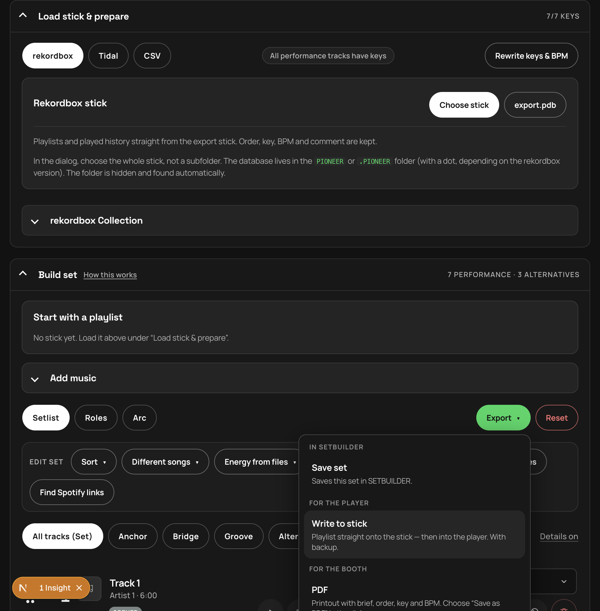
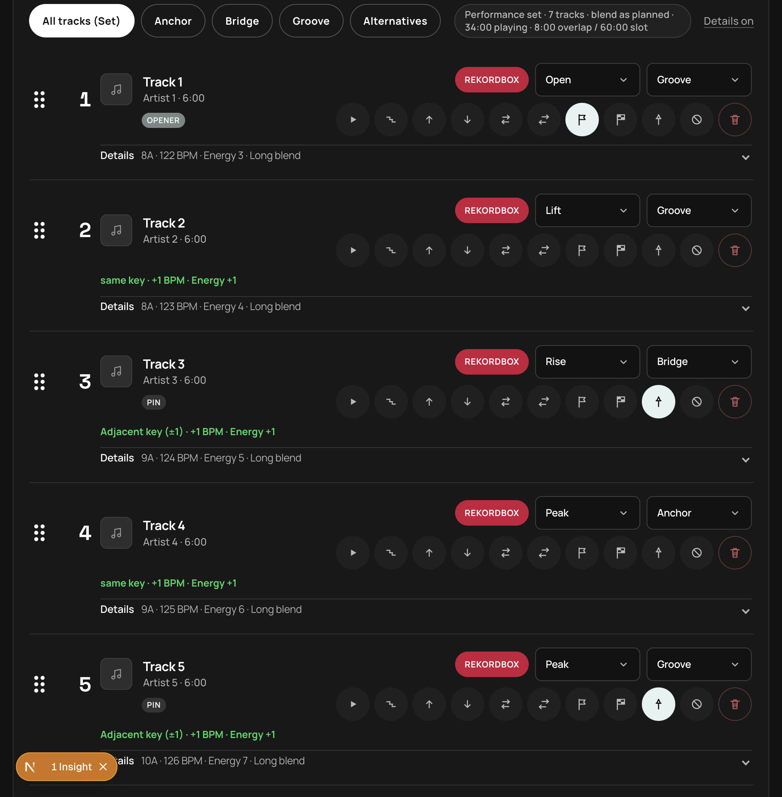
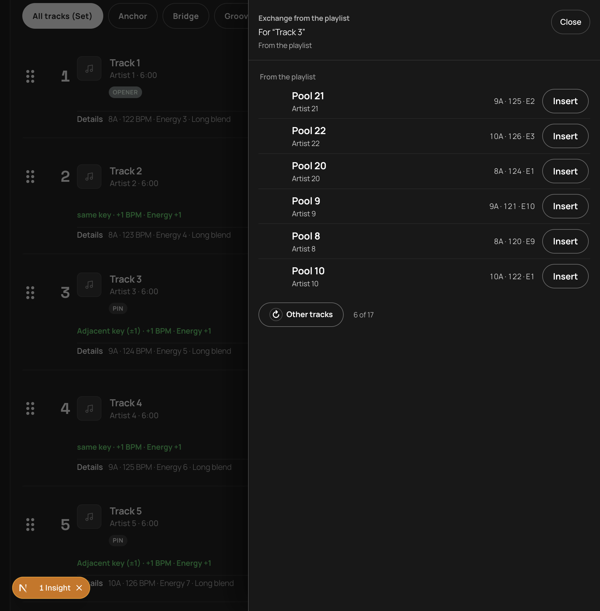
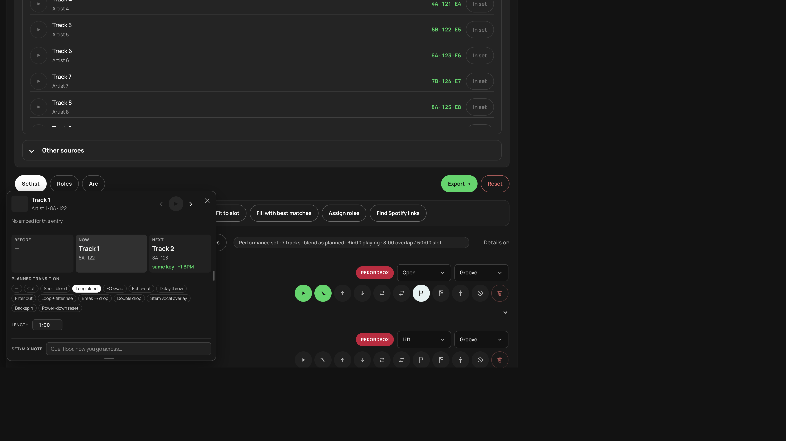
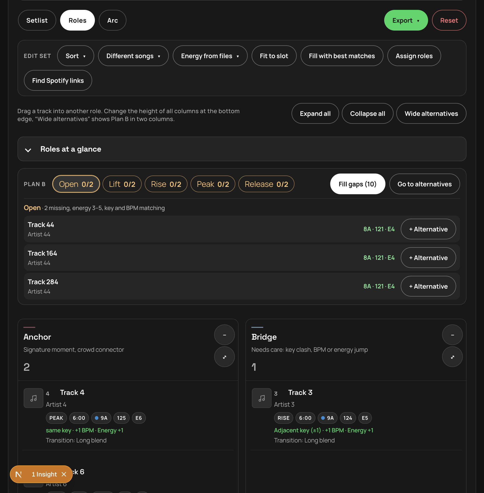
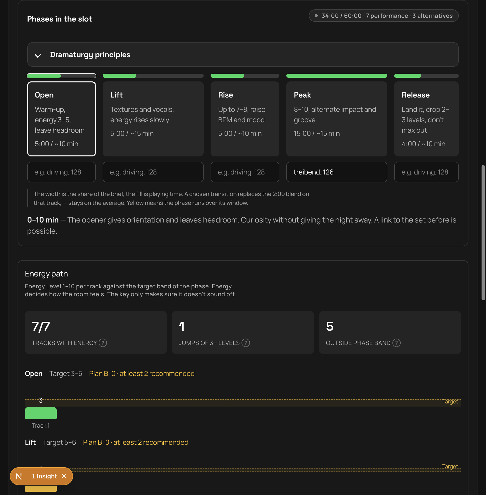
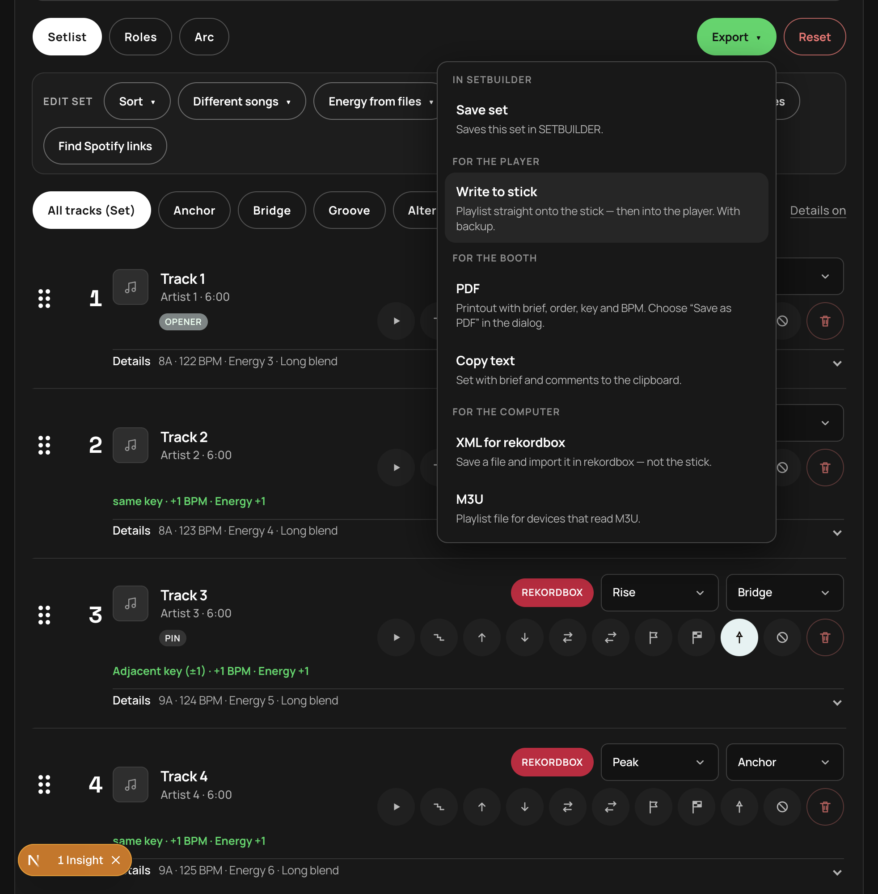

# SETBUILDER guide

[Deutsch](GUIDE.de.md) · **English** · [README](../README.md)

How to prepare a set with rekordbox: connect and understand the library → build → export. Screenshots show a set open in the app. The pictures are from 4.5. The words describe **4.7.6**, including the library filters, the phase line, pins and exclude, fit to slot (also when you change the slot minutes), Exchange from the playlist, Perfect · pins only, undo for Sort, the alternatives banner with the real performance place, energy on the details line and the booth sheet, and **Compact / Comfortable** on the setlist.

The shipping client is the desktop app (port **4317**). Browser development uses port **4327**. This document describes **4.7.6**. Stick write, players, and streaming accounts are still unverified.

> **Before the gig:** Always test the stick on the actual player (playlist visible, tracks playable). Keep a backup — SETBUILDER writes to `export.pdb` and keeps copies under `SETBUILDER-Backup/`, but you are responsible for your media. No warranty. Works on my machine. :)

## How a set works with rekordbox

1. **Brief:** title, slot duration in minutes, and average blend time. Those minutes are the clock **Fit to slot** uses: lengthen them, and the set fills; shorten them, and it cuts — the same run as the button once the minutes settle (briefly debounced). Set info (vibe, venue, slot, audience, gear, notes) folds away. The examples in those fields are placeholders, and the fields start empty. They are notes for the gig. The clock stays in the minutes above.
2. **Load stick & prepare:** connect the stick and optionally enrich the current set/library from collection XML, CSV or an unencrypted database.
3. **Build set:** start with a stick playlist, add music, or do both; then check phases, roles, order, and each join.
4. **Export:** save the set in SETBUILDER, update the stick playlist, make booth PDF/text, or export XML/M3U.

## 1. Load stick & prepare

**Rekordbox stick.** Prefer **Choose stick** (Chrome / Edge / desktop) for the volume root, or pick `PIONEER` / `PIONEER/rekordbox`. If the folder dialog fails or hangs, use **export.pdb** (`PIONEER/rekordbox/export.pdb` or `.PIONEER/…`) — the most reliable path. Avoid selecting the whole USB with every music file; that can stall. SETBUILDER finds the database itself, even in the hidden `PIONEER` or `.PIONEER` folder. It reads playlists and the played history. Each playlist id is kept once. A leftover copy of that same id, with parent 0 and sort 0, is dropped. Order, key and BPM are kept; Energy Level is read from the rekordbox comment when Mixed In Key wrote it there. Files from the stick can be previewed directly. Status text shows while the dialog is open, while files are listed, and while the database is read.

**Covers.** Art comes from `PIONEER/Artwork` on the stick (the larger `_m` file first, then the smaller JPEG). If that artwork file is missing, SETBUILDER reads the front cover from the MP3 ID3 APIC frame. Both paths need the stick folder in the current session.

**Player check.** After a stick is chosen, a short strip shows one verdict and one primary action (prepare for player, eject, or open rekordbox). Details sit behind a toggle: green / amber / red dots mark real status (folder, database, player library); plain lines without a dot are info only (e.g. no SETBUILDER playlists yet). Green means Device Library players can use the stick; amber means a step is still needed — often *Prepare for player* so the old OneLibrary no longer hides your playlists, then *Eject*.

**Collection enrichment.** In rekordbox, export via *File → Export Collection in XML…* and load the file. An unencrypted `master.db` and CSV work too. These sources index the library and match metadata such as key/BPM onto tracks already in the set; they do **not** start, replace or become the set by themselves. Playlist choice is under **Build set**. After import, the **Library** searches by artist, title, key or playlist. Under that search: key neighborhood (the same key, the relative major/minor, or ±1 on the wheel), BPM from/to, and energy from/to on the 1–10 scale. Those combine with the search and with **Fits after**, which ranks tracks that can follow a chosen set track. Adding one from that list inserts it right after the chosen song. With **All tracks** selected, the new song is appended. There is no danceability, emotion, or genre score. **5 others** pages through more matches.

**Energy.** The Energy Level (1–10) comes from Mixed In Key. SETBUILDER reads it from the rekordbox comment (for example `7A - Energy 6`, `Energie 6`), from Grouping / Label / Remixer in the collection XML or CSV (`Energy` / `Energie`), from a lone `6` or `E8` in those fields, or you set it by hand in the setlist. USB `export.pdb` has comments but not Grouping — reload tags in rekordbox and load the collection XML if energy stays empty.

**Set note.** In setlist details, **Set note** is booth-only (cue, floor). It appears in PDF and copied text, never in rekordbox Comments or ID3 tags.

**Energy from files.** When stick files are present, the menu separates **Read from tags** (no audio decode), **Measure missing**, **Recalculate all** (measure without writing), and **Write to MP3**. If no stick is connected, the menu shows that one prerequisite and **Choose stick**, which opens the existing stick picker under Load stick & prepare. If the stick is connected but no track has a file path, it shows that prerequisite instead of four empty actions. MP3 writes add `TXXX EnergyLevel` plus `Energy N` in the file comment; each replacement is reopened and byte-verified, and the original is restored if verification fails. Key, BPM, set notes and audio bytes stay unchanged. Reload tags in rekordbox afterwards; `export.pdb` and computer `master.db` are not edited by this action. Analysis uses [essentia.js](https://github.com/MTG/essentia.js) (AGPL-3.0). Calibration on real media is not verified.

## 2. Build set

Under **Build set**, choose **Start with a playlist** from the connected stick, use **Add music**, or combine both. Loading a playlist into a non-empty set asks:
- **Replace** overwrites the current setlist and offers one **Undo** back to the previous setlist.
- **Merge** keeps the current setlist and appends only tracks that are not already present.
- **Cancel** makes no change.

Collection XML/CSV/DB never triggers this choice because it only enriches metadata and the library.

Loading a **stick playlist** stores the full playlist pool on the set (`sourcePool`). That keeps **From the playlist**, **Exchange**, and refill from the same crate available even when the stick list is no longer selected. History starts do not store a pool.

Each track shows its source (rekordbox), phase and role. The number and the drag grip stay on the title line; opening details does not move them. Above the list you pick **Compact** or **Comfortable**. Comfortable shows phase, role and all icon buttons on the row: play, rehearse, up, down, energy (lightning, when the track has a file), **Exchange**, replace, opener (flag), closer (checkered flag), pin, exclude, and remove. Compact keeps the row tight — play, pin, exchange, exclude and remove stay visible; key, BPM and energy sit after the title. **Details** on the row (or **Details on** above the list) opens only the lower fields: set note, key, BPM, energy, transition and length. The summary line (“7A · 125 BPM · Energy 7 · Long blend”) stays visible when you fold those fields again. **Collapse** makes an expanded Compact row one line again; choosing **Compact** at the top resets the whole list. On an alternative, replace is **Into set**. Opener and closer are only on a song in the performance. Under the title, the join from the previous track (“Adjacent key (±1) · +1 BPM · Energy +1”) and the reasoning (“Why here”). Energy is shown only when the level is known. Unknown energy, and the old anonymous Energy 1, stay blank. **How this works**, next to Build set, says what each of those is for. Change the order by dragging the grip or with the arrows.

A transition marks how you go into the next track — cut, short blend, long blend, EQ swap, echo-out, and the others. It is not written into the audio file. “—” means no mark, and that join keeps the average blend from the brief. **Length** is the overlap: that time comes off the playing time, so the slot line and the overrun follow it. The last track still loses its overlap. Pick a length or type one. A length you set, including 0, wins over the time the transition suggests. If you leave it, the chosen transition suggests a time. **Reset**, beside Export, asks first and then clears the set.

**Replace** opens a drawer over the setlist, so the tracks below do not move. The header keeps the track name (“For «name»”). Focus moves into the drawer; Close, a click on the dimmed area, or Escape returns it to the replace button. Play in that list is the same round play button as on the setlist row. Insert swaps the title. The drawer sits above the floating player so Close stays clickable; the body scrolls inside the drawer while the page underneath is locked. Several drawers (Replace, Exchange, Into set, How this works) share the same scroll lock and only release it when the last one closes.

**Exchange** (its own icon before Replace) opens the same drawer shape, but only with tracks from the loaded playlist pool that fit key, BPM and energy at this position. Without a pool (fewer than two playlist tracks) the button is disabled and says to load a stick playlist as a set or extract a playlist first. Empty means no other playlist track fits here.

Preview plays in a compact floating card. Drag the title strip; pull the right edge wider and the bottom edge taller; the card stays inside the window. Close is at the top-right corner. Rehearse shows previous, this track, and next, with the same transition chips and length as the setlist. The card sits under the Replace/Exchange drawer; the player is reachable again once the drawer is closed.

**Opener, closer, and pins.** Pin a performance track as **Opener** (stays first, phase Open) or **Closer** (stays last, phase Release). A mid **pin** keeps that song in the set through **Fit to slot** and **Different songs**, and still lets it move when you sort — except **Perfect · pins only**, which only swaps mid-pins among themselves. Extract suggests warm open / release pins; you can change or clear them anytime. Sorting keeps pinned ends — and without a pin, the current first and last performance tracks stay at the ends anyway. **Exclude** marks a track out of the set. If it was in the performance, it moves to Alternatives and stays there. Fit to slot, refill, and Different songs leave it there. Clearing the exclude leaves it where it is. Pin and exclude clear each other: pinning clears the exclude, and excluding clears opener, closer, and the mid pin.

**Edit set**
- **Sort:** most techniques reorder only inside each phase (Alternatives stay at the end; opener/closer stay first/last overall). **Perfect · Max score** is different: it reorders the whole performance across phase seams, then re-lays Open→Release by timeline. **Perfect · pins only** reorders only mid-pins among themselves (Camelot TSP); non-pins stay in the gaps between pin slots; opener/closer and Alternatives stay. Needs at least two mid-pins — otherwise the entry is disabled. Same menu on the setlist and on the Key path. Sorting brings non-excluded Alternatives back into the performance and does not cut the set to the slot. If nothing moves, SETBUILDER says so — often key/energy/BPM are missing, or a phase has only one or two tracks.

  | Technique | What it does |
  |---|---|
  | **Perfect · Max score** | Whole-set Camelot TSP (exact Held-Karp ≤18 tracks, else NN+2-opt/Or-opt). Minimizes clashes first, then maximizes mix score. Opener/closer stay; phases are re-laid after. 100% needs keys that all connect on the wheel — disconnected clusters still leave a bridge clash |
  | **Perfect · pins only** | Mid-pins only among themselves (Camelot TSP). Non-pins stay in the gaps. Opener/closer and Alternatives stay. Needs at least two mid-pins |
  | **Harmonic** | Per phase: related Camelot keys, smooth energy, small BPM steps |
  | **One-step** | Per phase · Mixed In Key: energy prefers ±1 with the phase |
  | **Energy wave** | Per phase: climbs Open→Peak, falls in Release; key is the tie-breaker |
  | **Twin peak** | Per phase: in Peak build, dip ≈−2, climb again; Open/Lift/Rise only climb |
  | **Build tempo** | Per phase: BPM ramp with the phase |
  | **BPM chain** | Per phase: stay in the ±2–4 pocket |
  | **Camelot journey** | Per phase: clockwise around the wheel (does not stack the same key) |
  | **Waves** | Per phase: in Peak, groove ↔ impact (anchor); else low/high energy |

- **Different songs:** a short menu between Sort and Energy. **Different songs** uses the same pool as before (the playlist pool, otherwise the stick library). **From the playlist**, **From the collection**, and **From history** use that loaded source. **From the playlist** is ready once a stick playlist was loaded and the pool is stored on the set — even without a collection. An entry stays visible and is disabled, with a short reason, when its pool is not loaded. Confirms first; opener, closer, and mid-pins stay in the new draw, excluded tracks stay out, and notes are lost.
- **Energy from files:** with stick files present, read tags, measure missing, recalculate all, or explicitly write known levels to MP3. Measuring does not write files. Without a stick, the menu shows that prerequisite and **Choose stick**. Without file paths, it shows that prerequisite instead of four empty actions.
- **Fit to slot:** shortens the performance when it runs over the slot. A fit that starts over the slot only cuts. **Fill with best matches** is the separate action when the set is short: it adds tracks that fit key, BPM, and energy, Alternatives first, then the playlist stored with the set, until the slot is full. Excluded tracks stay out. Opener, closer, and mid-pins stay in. If nothing qualifies, the status says so. Changing **slot duration** in the brief runs the same fit/fill path as the button (briefly debounced) once the minutes settle and the set is over or under the slot. One undo banner names the **track** and the **return position** (for several: name and place in the list). A second fit replaces that snapshot.
- **Assign roles:** Anchor on the strongest Peak tracks and the closer, Bridge at a phase change, key clash, BPM or energy jump, otherwise Groove
- **Find Spotify links:** looks up a Spotify match for tracks without a link so you can preview them in the set (needs the Spotify credentials, see [Setup in the README](../README.md#setup)). Your rekordbox export is unaffected.

## 3. Roles and Plan B

Every track has a phase (Open → Lift → Rise → Peak → Release) and a role:

| Role | Job |
|---|---|
| **Anchor** | Crowd connector, signature track |
| **Bridge** | Pivot between phases: key, BPM, energy |
| **Groove** | Room to breathe between peaks |
| **Alternatives** | Plan B when the floor turns |

Drag titles between the columns. On an alternative, **Into set** places it before or after a song in the playlist, and **Pin** brings it into the performance and keeps it through fit to slot and Different songs. **Plan B** asks for at least two fitting alternatives per phase. An alternative counts for the phase you pick under “Replaces”, as long as its energy fits the phase's band. Otherwise the reason is shown on the card. “Fill gaps” takes suggestions from your rekordbox library that fit the phase's tracks by energy, key and BPM.

## 4. Arc

The arc shows how the phases fill the slot (active phase is highlighted; yellow means over the window) and how each track's energy sits against the phase's target band. Jumps of three levels or more are marked. Under each phase, one optional line says what that part is for — the placeholder reads “e.g. driving, 128”. An empty line is not stored. The set file stays version 1. The booth PDF prints the line on that phase's banner. Playing time follows the average blend time in the brief: 30 seconds, one minute, two minutes or four minutes off each track, and never less than 30 seconds of a short file. A marked join and its length replace that average on that track. Cue points and what you do live stay yours.

**Key path** shows Camelot along the played order. Each card has a short relation badge (Same, ±1, Clash, …), the key, energy when known, and BPM. Drag cards to reorder; use **Sort** for the techniques above (including Perfect · pins only). Three stats with a **?** explain the numbers:
- **Keys set** — share of performance tracks with a Camelot key
- **Mix score** — average of every transition (key and energy in equal parts, small BPM correction). Above ~75 % is smooth; below ~50 % often clashes
- **Clashes** — transitions whose keys sit far apart on the Camelot wheel

Sort (especially **Perfect · Max score**), drag, or change key/energy in the setlist to move the numbers. A clash can't be bought back with matching energy and BPM alone — if two Camelot clusters never touch (for example 1A/12A vs 8A/9A), Perfect still leaves the fewest possible bridge clashes.

| Phase | Energy target |
|---|---|
| Open | 3–5 |
| Lift | 5–6 |
| Rise | 6–8 |
| Peak | 8–10 |
| Release | 4–6 |

## 5. Export

Before anything leaves, a checklist asks about missing files, keys, energy, a thin Plan B, and whether you have heard the set on the player. Only a gap that would make that action a lie blocks it. If tracks have no file in this session, **Choose stick folder again** in that dialog picks the same folder once more so the files are back. In the player, rehearse the join: previous, this track, next, the transition mark and the set note.

The **Export** menu is grouped by where the set goes next. **Save set**, under In SETBUILDER, opens the existing save under Connections & setups. It does not run the checklist and does not write the stick.

### For the player

- **Write to stick** (main path): playlist `SETBUILDER - <title>` plus alternatives as `SETBUILDER - <title> Alternatives` in the **current** `export.pdb`. Creating or updating those named playlists is targeted and transactional: unrelated database changes are preserved, a backup is made, the result is read back, and failure rolls back. Only tracks already on the stick are written; ambiguous near-matches require an explicit choice. XML and M3U also land in `SETBUILDER/`. The health strip can prepare older Device Library players and offers eject. CDJ-3000X, XDJ-AZ and OPUS-QUAD still need rekordbox for OneLibrary; behavior across CDJ/XDJ families must be checked on the actual hardware. The computer `master.db` is never touched.

### For the booth

- **PDF:** print view with brief, order, key, BPM, energy when the level is known (otherwise a dash), a phase line when you wrote one, and booth-only set notes (save as PDF in the print dialog).
- **Copy text:** set with brief, known energy, and booth-only set notes to the clipboard. Unknown energy is left off the line.

### For the computer

- **XML for rekordbox:** file `SETBUILDER-rekordbox.xml` to *import* in rekordbox — not writing the stick. In rekordbox set *Preferences → Advanced → Database → rekordbox xml* to this file once; then left tree → *rekordbox xml* → right-click → *Import Playlist*. Performance and alternatives come as two playlists.
- **M3U:** playlist file for devices that read M3U

Under **Connections & setups** you can save the brief and the set as a setup, load it again, or back it up as JSON. The save name follows the set title from the brief.

## Heavy work and verification boundaries

Stick reconnect/import, collection import, energy tag reads, measurements and writes are named heavy jobs. They run in one queue: status shows the running job or queue position, and heavy operations never run in parallel. The rest of the UI remains available.

Chrome and the installed desktop app have shown a real stick read-only (collection, playlists, history, a loaded set, covers). Stick write, CDJ/XDJ playback, Spotify/Tidal accounts, eject, and energy calibration on real media are not verified. SETBUILDER also cannot prove browser folder permissions, USB disconnect/full-disk handling, rekordbox import/tag reload, print/clipboard integration, or codec coverage. Verify the paths you rely on before a gig.

## More sources

rekordbox is the main route. If keys are missing, Tidal (key and BPM from the catalog via ISRC), CSV or paste fill them in. Titles that aren't in rekordbox yet come into the set by link from Spotify, Tidal, Beatport or SoundCloud. Beatport and SoundCloud need no login: the title comes from the address, and you enter key and BPM by hand or get them through rekordbox.

## Further reading

- [README](../README.md) — setup, desktop download, languages, tests, license
- [Desktop packaging](../desktop/README.md) — build, signing, quarantine
